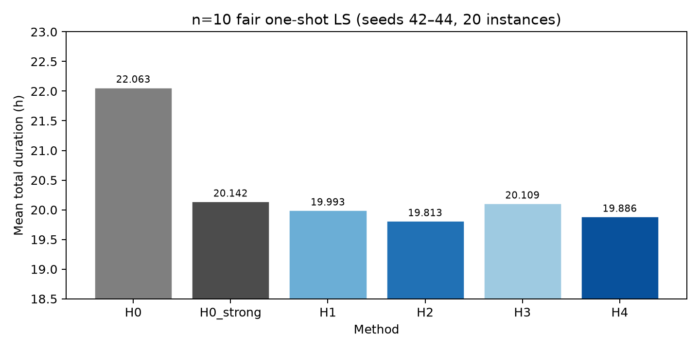
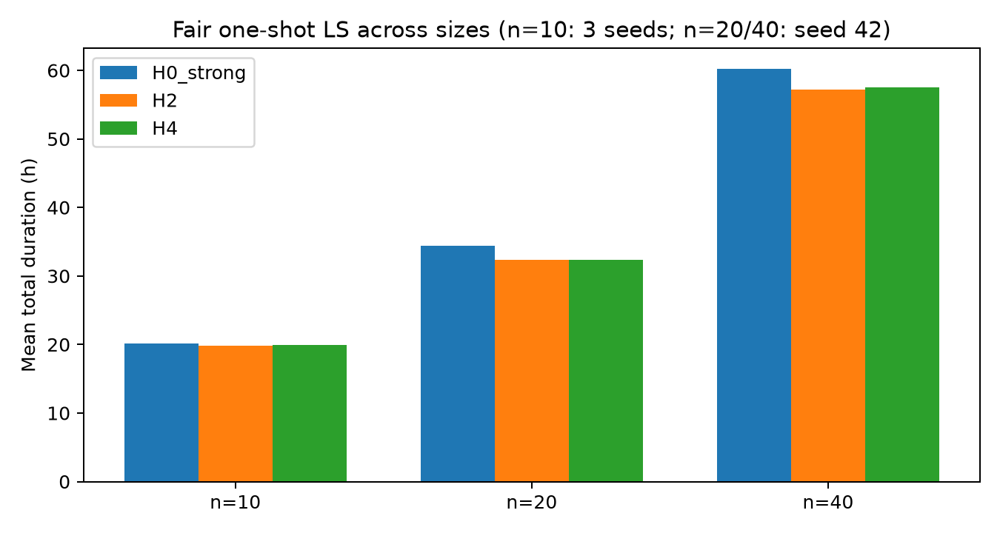
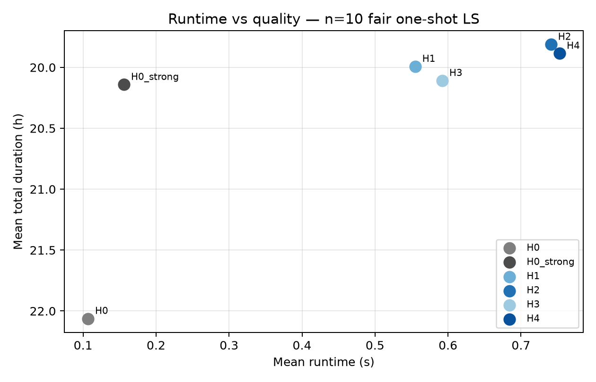
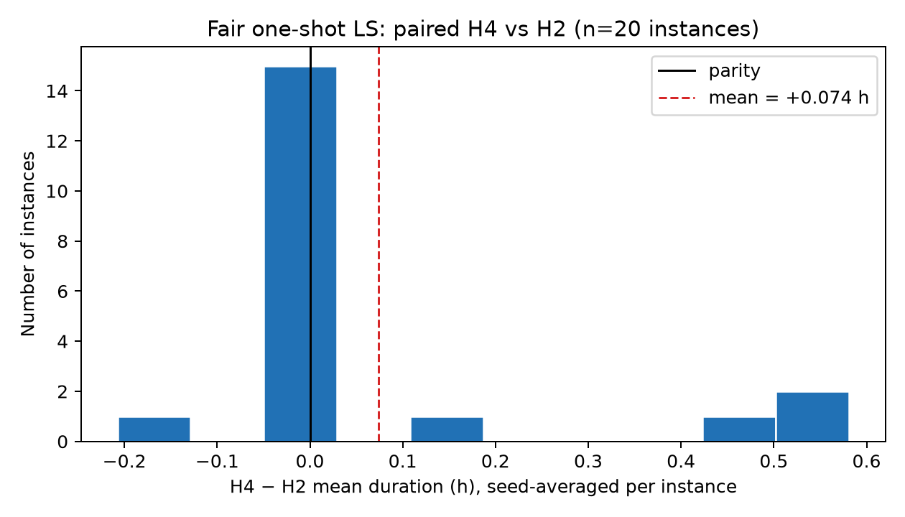
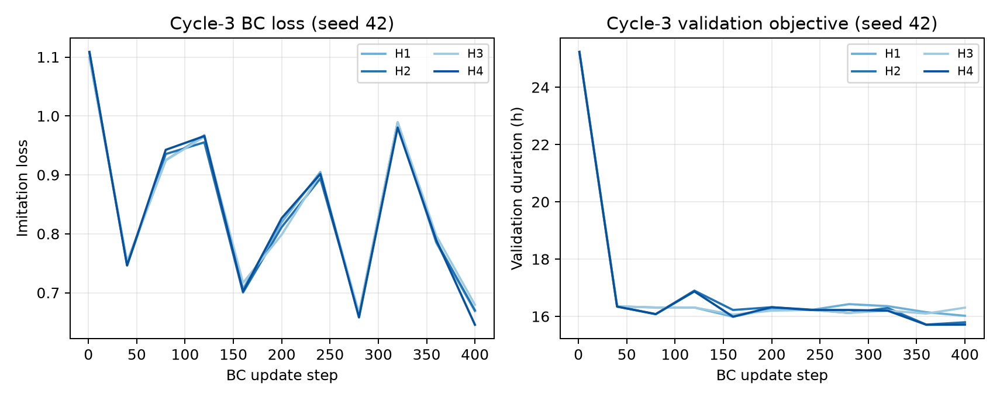

# History-Aware Transformer Agents with DeepSets Coordination for Electric Vehicle Routing with Nonlinear Charging

**HAT-EVRP-NL — research manuscript**  
Results index: `results/README.md`  
Cycle-3 baseline tables: `results/FINAL_REPORT.md`  
Publication tables/figures: `results/tables/`, `results/figures/`  
Raw evidence: `results/raw/`

---

## Abstract

The electric vehicle routing problem with nonlinear charging functions (E-VRP-NL) requires sequencing customers under battery and route-duration limits while optimizing piecewise-linear concave charging at stations. We study whether *encoding each EV’s visit history with a shared causal Transformer* and *aggregating open-route embeddings with DeepSets* improves neural construction on Montoya’s static offline benchmark when charging is optimized by an exact fixed-route solver (`frvcpy`). We implement HAT-EVRP-NL: static node encoding, shared causal history Transformer, dynamic EV-state fusion, DeepSets fleet aggregation, hierarchical route/customer decoding, nonlinear charging optimization, and an independent Python forward simulator for feasibility. Controlled ablations H1–H4 isolate history and DeepSets. On the twenty official 10-customer instances (seeds 42–44), fair best-of-N plus one-shot local search yields mean durations H0_strong 20.142 h, H1 19.993 h, **H2 19.813 h**, H3 20.109 h, H4 19.886 h (lower is better). History improves over state-only routing (H2−H1: −0.180 h; 80%/10%/10% win/tie/loss). DeepSets does **not** reliably improve over history alone (H4−H2: +0.074 h; 95% CI [−0.018, +0.165]; 20%/60%/20%). History-aware policies with fair local search improve on the tested classical greedy+LS baseline on n=10–40. Under the **corrected** literature-compatible objective (travel + nonlinear charging; service excluded), n=10 fair-LS gaps vs Froger et al. (*Transportation Science*, 2022; online Dec. 2021, Table 13) are on the order of ~5% for H2—not the obsolete ~43% figure obtained by wrongly comparing full duration to literature BKS. Post-Cycle-3 recovered hybrid search further improves n=40 means (H2 56.806 h, H4 56.370 h vs historical fair-LS 57.173 / 57.506 h; single seed; unequal search compute). Direct learned charging is unreliable (4/20 feasible). **Contribution:** an experimental evaluation of history-aware, fleet-aware neural hybrid routing with nonlinear charging—not a new state-of-the-art E-VRP solver. H2 is the strongest efficient neural variant on the matched Cycle-3 fair-LS protocol; H4 is the complete architecture without a consistent multi-seed DeepSets win.

---

## 1. Introduction

Battery-electric fleets introduce charging time that is *nonlinear* in remaining capacity: charging slows as the battery approaches full. Planning routes therefore couples customer sequencing with station choice and charge quantity. Montoya et al. (2017) formalized this setting as E-VRP-NL and released a widely used benchmark with piecewise-linear charging curves and a maximum route duration.

Neural construction heuristics—especially attention-based models (Kool et al., 2019)—have advanced classical VRP variants by learning sequential decisions from data. E-VRP-NL adds two representation questions that matter for *learned* construction:

1. **Route history.** Beyond a fixed-size state vector (location, SOC, elapsed time), does a causal encoding of the EV’s visit sequence improve the next customer decision?
2. **Fleet coordination.** When several routes are open, does a permutation-invariant set function over open EVs (DeepSets; Zaheer et al., 2017) improve route selection?

We evaluate these questions with a *hybrid* pipeline: the neural policy proposes customer orders; `frvcpy` (Kullman et al., 2021) solves the fixed-route vehicle charging problem (FRVCP) for each candidate order; a same-project Python forward simulator validates SOC, duration, and coverage. We do **not** claim global routing optimality from `frvcpy`, nor third-party checker certification.

**Experimental contributions (non-exaggerated).**

- A reproducible HAT-EVRP-NL architecture and H1–H4 ablations on Montoya E-VRP-NL.
- Fair protocols separating equal constructions, best-of-N + identical one-shot local search, and corrected wall-clock comparisons.
- Evidence that Transformer history helps; DeepSets does not consistently help; hybrid charging is necessary; corrected lit BKS gaps are moderate (~5% on n=10 fair-LS), not the misaligned ~43% figure.

---

## 2. Related Work

**E-VRP-NL formulation and metaheuristics.** Montoya, Guéret, Mendoza, and Villegas (2017) introduced E-VRP-NL with nonlinear charging, partial recharge, and a 120-instance testbed, and proposed an ILS+HC hybrid. DOI: [10.1016/j.trb.2017.02.004](https://doi.org/10.1016/j.trb.2017.02.004).

**Formulations and fixed-route charging.** Froger, Mendoza, Jabali, and Laporte (2019) developed improved MILP formulations and FRVCP algorithms (including labeling). DOI: [10.1016/j.cor.2018.12.013](https://doi.org/10.1016/j.cor.2018.12.013).

**Capacitated stations and uncapacitated BKS updates.** Froger, Jabali, Mendoza, and Laporte (2022), *Transportation Science* 56(2):460–482 (published online 30 Dec 2021), study capacitated charging stations and, for the *uncapacitated* E-VRP-NL, report improved best-known solutions on many Montoya instances (abstract: new BKS for 80 of 120). DOI: [10.1287/trsc.2021.1111](https://doi.org/10.1287/trsc.2021.1111). Our reference file `results/literature_bks_froger2021.csv` stores per-instance values attributed to **Table 13** of that work’s extended materials for the uncapacitated comparison; several n=10 entries (e.g., `tc0c10s2cf1` = 19.75 h) match values appearing in the publicly available HAL PDF of that paper. We treat these as **literature BKS for gap reporting**, not as independently re-optimized optima in this repository.

**Exact/heuristic algorithms for E-VRP-NL.** Liang, Dabia, and Luo (2021, arXiv:2108.01273) propose branch-and-price-and-cut and a tabu search for E-VRP-NL. We cite this line as complementary exact/heuristic progress; we do not reimplement it.

**Deep Sets.** Zaheer et al. (2017), *NeurIPS*, introduce permutation-invariant set functions of the form \(\rho(\sum_i \phi(x_i))\).

**Attention-based learned routing.** Kool, van Hoof, and Welling (2019), ICLR, present the Attention Model for TSP/VRP-style construction with REINFORCE training.

**`frvcpy`.** Kullman, Froger, Mendoza, and Goodson (2021), *INFORMS Journal on Computing*, provide an open-source FRVCP labeling solver. DOI: [10.1287/ijoc.2020.1035](https://doi.org/10.1287/ijoc.2020.1035). Scope: optimal charging *given a fixed customer order*—not joint routing.

---

## 3. E-VRP-NL Mathematical Formulation

We follow Montoya et al. (2017) for the uncapacitated E-VRP-NL used in this study.

### 3.1 Sets and parameters

- \(N = \{0\} \cup C \cup S\): depot \(0\), customers \(C\), charging stations \(S\).
- Unlimited homogeneous fleet of EVs with battery capacity \(Q\) (Wh).
- Travel time \(t_{ij}\) (h) and energy \(e_{ij}\) (Wh) for each arc \((i,j)\).
- Service time \(s_i\) at customers (and zero or as specified at other nodes).
- Maximum route duration \(T_{\max}\) (here \(T_{\max}=10\) h on the official instances).
- Station-specific piecewise-linear concave charging curves relating SOC to charging time; partial charging is allowed.
- No customer time windows, no cargo capacity, no station queues, and no requirement that charging occur only at the depot.

### 3.2 Decisions (conceptual)

A solution is a set of routes. Each route is an ordered sequence of nodes starting and ending at the depot, visiting a subset of customers, possibly inserting stations with charge quantities. Every customer in \(C\) is visited **exactly once** across all routes.

### 3.3 Charging and energy

Along a concrete stop sequence \((i_0,\Delta q_0),\ldots,(i_m,\Delta q_m)\) with \(i_0=i_m=0\), SOC evolves by subtracting travel energy and adding charge \(\Delta q\) at stations subject to \(0 \le \mathrm{SOC} \le Q\). Charging time at a station is given by the station’s piecewise-linear function evaluated between arrival and departure SOC.

### 3.4 Objective

Minimize total duration over all routes:

\[
\min \;\; \sum_{r \in \mathcal{R}}
\Bigl(
\underbrace{\text{travel time}}_ {\text{arcs in } r}
+ \underbrace{\text{service}}_ {\text{customers in } r}
+ \underbrace{\text{charging time}}_ {\text{stations in } r}
\Bigr)
\]

subject to energy feasibility, \(T_{\max}\) per route, and exact customer coverage. Lower objective is better.

---

## 4. Proposed HAT-EVRP-NL Method

### 4.1 Overview

HAT-EVRP-NL constructs multi-route solutions sequentially. At each decision step the policy selects either an open EV or a new route, then a customer (or close). After customer-order updates, `frvcpy` revises the *mutable* charging plan for the affected route. Feasibility masks and post-hoc Python simulation enforce physics.

**Immutable vs. mutable structure.**

- **Immutable:** the ordered list of *customer decisions* that define routing intent.
- **Mutable:** station insertions and charge quantities returned by FRVCP for that fixed customer order.
- History features (SOC/time) may describe the *current optimized planned route*, not only physically completed past visits; features are rebuilt when `frvcpy` revises the plan (`plan_visit_features` in `model.py`).

`frvcpy` does **not** solve the global E-VRP-NL; it optimizes charging conditional on a fixed customer sequence.

### 4.2 Static node encoder

Each node \(i\) is mapped to an embedding \(x_i \in \mathbb{R}^{d}\) from static features (coordinates, type, service, distances/energies to depot, etc.; input dimension 13 in the implementation) via an MLP:

\[
x_i = \mathrm{MLP}_{\mathrm{node}}(f_i),\qquad d=128.
\]

### 4.3 Shared causal visit-history Transformer

For an open EV, visit tokens concatenate \(x_{i_t}\) with an 8-dimensional visit feature vector (normalized arrival/departure time and SOC, travel energy, charge amount/duration, node kind). A causal TransformerEncoder (2 layers, 4 heads, \(d=128\)) produces history states; the last state is the route history vector \(h\).

Ablation **H1/H3** disable history (no causal encoding of visits). **H2/H4** enable it.

### 4.4 Dynamic route-state fusion

Explicit dynamic state \(s\) (remaining time budget, SOC, etc.) is fused with history:

\[
v = \mathrm{MLP}_{\mathrm{fuse}}([h;\, x_{\mathrm{loc}};\, s]).
\]

### 4.5 DeepSets fleet aggregation

Over open-route vectors \(\{v_k\}\):

\[
g = \rho\Bigl(\sum_k \phi(v_k)\Bigr),
\]

with MLPs \(\phi,\rho\). Ablation **H1/H2** disable DeepSets; **H3/H4** enable it. Global context combines \(g\) with problem-level features.

### 4.6 Hierarchical decoding

1. **Route head:** score each open EV embedding and a learned “new route” token; sample/argmax a route choice under masks.
2. **Customer head:** pointer-style scores between a query from the selected route context and customer keys, plus relative geometric features and a close-route logit; infeasible actions are masked.

### 4.7 Nonlinear charging via `frvcpy`

For a fixed customer order, FRVCP inserts stations/charges minimizing route duration subject to energy and \(T_{\max}\). Oracle call counts in evaluation CSVs measure these invocations.

### 4.8 Feasibility validation

`charging.check_route` / `check_solution` independently forward-simulate depot departures/returns, unique customer coverage, SOC, nonlinear charging time, and \(T_{\max}\). Reported objectives equal sums of simulated route durations when checks pass. This is **same-project Python validation**, not an external Java/DIMACS certification.

### 4.9 Ablations

| ID | History Transformer | DeepSets | Role |
|---|---|---|---|
| H1 | no | no | state-only neural baseline |
| H2 | yes | no | history-aware (strongest efficient neural) |
| H3 | no | yes | DeepSets without history |
| H4 | yes | yes | **complete proposed architecture** |

Classical references: **H0** (greedy construction; no/minimal local search as configured) and **H0_strong** (randomized greedy + local search). In Protocol A below, H0_strong still uses local search while neural rows are construction-only—so H0_strong is a *stronger reference*, not an equal unrefined peer.

---

## 5. Training Methodology

Training uses **independent synthetic instances**; official Montoya instances are held out for evaluation.

**Teachers.** Feasible greedy/local-search teachers provide expert multi-route constructions. Cycle-3 used interleaved multi-open-route imitation (`interleaved_actions`): per-route customer order is preserved while deciding among open routes, so DeepSets receives multi-open training signals when enabled.

**Losses.** Behavior cloning on masked categorical decisions; optional short REINFORCE fine-tuning. Best validation checkpoint is retained (not necessarily the last RL iterate).

**Hyperparameters (implemented defaults / Cycle-3 commands in `results/notes.md`).**

- Embedding \(d=128\), Transformer layers \(=2\), heads \(=4\).
- Cycle-3 routing: `--steps 400 --rl-steps 40 --train-instances 120 --val-instances 12 --eval-every 40`, seeds \(\{42,43,44\}\), version `c3`.
- Direct CHARGE controller: separately trained (`--steps 3000 --train-instances 120`, seed 42).
- Device: **CPU** (training logs record `device=cpu`).
- No extensive hyperparameter search was performed; scale is modest relative to industrial metaheuristics.

Checkpoints: `checkpoints/{H1,H2,H3,H4}_n10_seed{42,43,44}_c3.pt`.

---

## 6. Experimental Setup

**Benchmark.** Official Montoya E-VRP-NL instances (VRP-REP resource associated with Montoya et al., 2017). Primary evaluation: all **20** instances with \(|C|=10\). Scale tests: all **20** with \(|C|=20\) and \(|C|=40\) (seed 42). Exploratory: **3** instances with \(|C|=80\) (sample only). Sizes 160 and 320 were **not** evaluated.

**Methods.** H0, H0_strong, H1–H4 as above; hybrid charging via `frvcpy` unless noted.

### Protocol A — Equal construction counts

Neural methods: \(N\) sampled constructions **without** local search.  
**H0_strong still applies local search** and must be read as a stronger classical reference, not as “no LS.”  
Raw: `compare_size10_seed{42,43,44}_c3.csv`.

### Protocol B — Fair one-shot local search (primary)

1. Best-of-\(N\) constructions without per-sample LS.  
2. Apply **identical** `local_search` once (same passes/budget) to each method’s best construction.  

This equalizes local-search *applications*, not total oracle calls or wall time. Neural methods still incur construction-sample oracle cost.  
Raw: `compare_size10_fairls_final_seed{42,43,44}_c3.csv`.

### Protocol C — Corrected measured wall-clock

Match measured neural runtime; classical uses genuine multi-restart randomization (`deterministic_first` once). Superseded non-randomized wall-clock files are excluded (`results/INVALID_wallclock_fair_seed42_c3.md`).  
Raw: `compare_size10_wallclock_final_seed42_c3.csv` (seed 42 only).

**Statistics.** Instance-paired comparisons average seeds within each of the 20 instances. Tie tolerance \(10^{-9}\) on mean duration. Wins+ties+losses = 100%. File: `results/FINAL_paired_by_instance.csv`.

**Validation.** Python forward simulator only. No Java / external checker installation.

---

## 7. Main Results

Lower mean duration is better. Means use full CSV precision; tables round to three decimals for readability.

### 7.1 Protocol A — Equal constructions (n=10; neural without LS)

| Method | Mean h | Median h | Routes | Charge stops | Charge h | Runtime s | Oracle | Feasible |
|---|---:|---:|---:|---:|---:|---:|---:|---|
| H0 | 22.063 | 22.698 | 2.867 | 4.300 | 1.863 | 0.117 | 315 | 60/60 |
| H0_strong† | **20.142** | 18.586 | 2.800 | 3.650 | 1.535 | 0.176 | 528 | 60/60 |
| H1 | 21.249 | 19.333 | 3.000 | 3.900 | 1.761 | 0.460 | 515 | 60/60 |
| H2 | 20.966 | 19.627 | 3.000 | 3.867 | 1.659 | 0.646 | 520 | 60/60 |
| H3 | 22.131 | 21.060 | 3.000 | 4.083 | 1.871 | 0.490 | 497 | 60/60 |
| H4 | 20.975 | 19.185 | 3.100 | 3.717 | 1.641 | 0.671 | 525 | 60/60 |

†H0_strong includes local search; neural rows do not. Without LS, neural methods do not beat H0_strong on average (paired H2 vs H0_strong: 20%/0%/80%).

### 7.2 Protocol B — Fair one-shot LS (primary; n=10)

| Method | Mean h | Median h | Routes | Charge stops | Charge h | Runtime s | Oracle | Feasible |
|---|---:|---:|---:|---:|---:|---:|---:|---|
| H0 | 22.063 | 22.698 | 2.867 | 4.300 | 1.863 | 0.107 | 315 | 60/60 |
| H0_strong | 20.142 | 18.586 | 2.800 | 3.650 | 1.535 | 0.156 | 528 | 60/60 |
| H1 | 19.993 | 18.429 | 2.950 | 3.433 | 1.485 | 0.555 | 750 | 60/60 |
| **H2** | **19.813** | **18.378** | 2.917 | 3.433 | 1.465 | 0.741 | 747 | 60/60 |
| H3 | 20.109 | 18.445 | 2.933 | 3.517 | 1.534 | 0.592 | 729 | 60/60 |
| H4 | 19.886 | 18.586 | 3.033 | 3.350 | 1.414 | 0.753 | 753 | 60/60 |

Source: `FINAL_n10_fairls.csv` (H0_strong 20.141634… → 20.142; H2 19.812660… → 19.813; H4 19.886265… → 19.886).

Neural fair-LS uses ~1.4× oracle calls and ~4–5× runtime vs H0_strong.

### 7.3 Protocol C — Corrected wall-clock (n=10, seed 42)

| Method | Mean h | Runtime s | Oracle | Feasible |
|---|---:|---:|---:|---|
| H0 | 20.758 | 0.471 | 2632 | 20/20 |
| H0_strong | 19.895 | 0.412 | 2466 | 20/20 |
| H1 | 20.164 | 0.359 | 775 | 20/20 |
| **H2** | **19.586** | 0.448 | 760 | 20/20 |
| H3 | 20.196 | 0.380 | 771 | 20/20 |
| H4 | 19.840 | 0.458 | 745 | 20/20 |

Unique classical constructions ≈40+ per instance under the fixed RNG protocol. H2 best among these; H4 does not beat H2.

### 7.4 Scale (fair LS)

| Size | H0_strong | H2 | H4 | Feasible | Notes |
|---|---:|---:|---:|---|---|
| n=20 | 34.420 | 32.332 | 32.322 | 20/20 | seed 42 |
| n=40 | 60.195 | 57.173 | 57.506 | 20/20 | seed 42 |
| n=80 | 95.506 | 88.151 | 88.151 | 3/3 | **3-instance sample only** |

---

## 8. Ablation and Statistical Analysis

Fundamental comparison: **H4 vs H2** (DeepSets incremental value given history).

### 8.1 Instance-paired fair one-shot LS (n=20)

| Pair | Mean Δ (h) | 95% CI | Wins | Ties | Losses |
|---|---:|---|---:|---:|---:|
| H2−H1 | −0.180 | [−0.317, −0.044] | 80% | 10% | 10% |
| H3−H1 | +0.116 | [−0.151, +0.384] | 25% | 5% | 70% |
| **H4−H2** | **+0.074** | **[−0.018, +0.165]** | **20%** | **60%** | **20%** |
| H2−H0_strong | −0.329 | [−0.699, +0.041] | 65% | 20% | 15% |
| H4−H0_strong | −0.255 | [−0.631, +0.120] | 50% | 20% | 30% |

Source: `FINAL_paired_by_instance.csv` (`fair_one_shot_ls`). Δ = left − right in the pair label (e.g., H4−H2 > 0 means H4 worse).

**Supported:** history helps (H2 vs H1 CI excludes 0).  
**Not supported:** DeepSets benefit (H4−H2 CI includes 0; mostly ties). H3 does not beat H1.  
**Qualified:** H2 beats H0_strong on 65% of instances, but the mean-Δ CI includes values near zero—treat as suggestive under this budget, not a sweeping dominance claim.

### 8.2 Hypotheses for the null DeepSets effect (not demonstrated facts)

On this *static offline* benchmark with unlimited fleet and exact post-hoc charging, open-route set aggregation may be weakly informative once a strong per-route history encoding exists; local search may also absorb coordination mistakes. These are interpretive hypotheses only.

### 8.3 Compute overhead

Under fair LS, H2/H4 spend substantially more runtime and FRVCP calls than H0_strong for modest mean gains. Efficiency favors H2 over H4 when quality is comparable.

---

## 9. Benchmark Best-Known-Solution Analysis

**Provenance.** Values in `literature_bks_froger2021.csv` are labeled from Froger et al. (2022 / online 2021) **Table 13** materials for the *uncapacitated* Montoya benchmark (not the capacitated E-VRP-NL-C variant). Spot checks against the public HAL PDF (e.g., `tc0c10s2cf1` = 19.75, `tc0c10s2ct1` = 12.30, `tc1c10s2cf2` = 9.03) agree. We still mark full table-wide independent re-extraction as **repository-curated literature references**, not a claim that every row was re-validated by us against publisher typesetting.

**Objective convention.** Montoya et al. (2017) minimize travel + charging time; service time appears in the route-duration constraint. Our implementation reports full duration (travel + service + charging) for feasibility. For BKS comparison we also report literature-compatible duration = full − Σ customer service (constant once all customers are served; n=10 ⇒ −5.0 h). Evidence that published BKS omit service includes `tc2c40s5cf3` (BKS 19.65 h < 20 h total service).

**Gaps (n=10 fair LS Cycle-3 vs Table 13):**

| Method | Incorrect naive gap (full vs BKS) | Corrected lit gap |
|---|---:|---:|
| H0_strong | 44.8% | **7.1%** |
| H2 | 42.7% | **5.0%** |
| H4 | 43.2% | **5.4%** |

Sources: `results/raw/cycle3/FINAL_n10_bks_gaps.csv` (naive), `results/raw/cost_aware/IMPROVEMENT_bks_gaps_corrected.csv`. Corrected gaps remain below specialized BKS but are far smaller than the earlier misaligned 43% figure. Optional post-freeze inference/search improvements (oracle-aware scoring, stronger LS, recovered hybrid) further reduce objectives; see `results/archive/reports/IMPROVEMENT_REPORT.md` and `results/REGRESSION_RECOVERY_REPORT.md`.

**Matched-λ caveat.** Comparing H2 at λ=2 with H4 at λ=4 confounds architecture with the inference weight. Under identical λ ∈ {0,2,4} and identical strong LS, layout-clustered H4−H2 intervals include zero; at λ=4, H2 achieves the best mean (19.335 h, ~0.60% lit gap). The 20 official n=10 instances comprise only five customer layouts. Details: `results/archive/reports/TARGETED_IMPROVEMENT_REPORT.md`.

---

## 10. Learned Nonlinear Charging Ablation

A separate controller predicts GO vs CHARGE, station selection, and target SOC. On 20 n=10 instances (seed 42, Cycle-3):

| Method | Feasible complete solutions |
|---|---|
| `direct_CHARGE` | **4/20** |
| `hybrid_H4` (`frvcpy`) | 20/20 |
| `direct_plus_repair` (frvcpy repair) | 20/20 |

Source: `results/raw/misc/direct_charge_size10_seed42_c3.csv`. Feasible-only objective averages for the 4/20 successes are **not** used as evidence of superiority (selection bias). Calling `frvcpy` after failure demonstrates repair, **not** successful learned charging.

---

## 11. Limitations and Future Work

- Modest training scale (Cycle-3: 400 BC + 40 RL steps; 120 synthetic train instances); three seeds at n=10 only.
- Wall-clock protocol reported for a single seed.
- CPU-only experiments.
- n=80 is a three-instance sample; 160/320 unevaluated.
- Neural methods cost more FRVCP/runtime than H0_strong under fair LS.
- Corrected lit BKS gaps remain nonzero (~5% on n=10 fair-LS); the obsolete ~43% figure must not be cited.
- No consistent multi-seed DeepSets advantage; unreliable direct learned charging.
- Recovered n40 hybrid gains are single-seed and use unequal realized search compute.
- Python-only validation (no external checker).

**Possible future directions (not implemented here):** larger training; GPU; stronger classical/neural baselines; full large-instance evaluation; external checker cross-certification; alternative fleet coordination mechanisms.

---

## 12. Conclusion

HAT-EVRP-NL demonstrates that **causal Transformer visit histories** improve neural hybrid construction for Montoya E-VRP-NL relative to a state-only neural policy, when charging is handled by an exact FRVCP solver. **DeepSets fleet aggregation**—though implemented and trained with multi-open signals—does **not** consistently improve over history-only H2; H4 must not be described as superior to H2. With fair one-shot local search, history-aware policies can improve upon the tested classical greedy+LS baseline on n=10–40 instances, at higher computational cost, while remaining far from published best-known solutions. Direct learned charging is not reliable. The primary DeepSets coordination hypothesis is **negative**; the history hypothesis is **supported**. The project is a completed experimental study of history-aware hybrid neural routing with nonlinear charging optimization—not an SOTA E-VRP solver.

**Definitive files:** `paper_draft.md` (this manuscript), `results/FINAL_REPORT.md`, `results/FINAL_*.csv`, `results/figures/`.

---

## References

1. Montoya, A., Guéret, C., Mendoza, J. E., & Villegas, J. G. (2017). The electric vehicle routing problem with nonlinear charging function. *Transportation Research Part B: Methodological*, 103, 87–110. https://doi.org/10.1016/j.trb.2017.02.004

2. Froger, A., Mendoza, J. E., Jabali, O., & Laporte, G. (2019). Improved formulations and algorithmic components for the electric vehicle routing problem with nonlinear charging functions. *Computers & Operations Research*, 104, 256–294. https://doi.org/10.1016/j.cor.2018.12.013

3. Froger, A., Jabali, O., Mendoza, J. E., & Laporte, G. (2022). The electric vehicle routing problem with capacitated charging stations. *Transportation Science*, 56(2), 460–482. Published online 30 Dec 2021. https://doi.org/10.1287/trsc.2021.1111

4. Liang, Y., Dabia, S., & Luo, Z. (2021). The electric vehicle routing problem with nonlinear charging functions. arXiv:2108.01273.

5. Zaheer, M., Kottur, S., Ravanbakhsh, S., Poczos, B., Salakhutdinov, R., & Smola, A. (2017). Deep Sets. *Advances in Neural Information Processing Systems (NeurIPS)*.

6. Kool, W., van Hoof, H., & Welling, M. (2019). Attention, Learn to Solve Routing Problems! *International Conference on Learning Representations (ICLR)*.

7. Kullman, N. D., Froger, A., Mendoza, J. E., & Goodson, J. C. (2021). frvcpy: An open-source solver for the fixed route vehicle charging problem. *INFORMS Journal on Computing*. https://doi.org/10.1287/ijoc.2020.1035

---

## Architecture diagram

