# History-Aware Neural Electric Vehicle Routing with DeepSets Fleet Coordination and Exact Nonlinear Charging Optimization

**HAT-EVRP-NL — research manuscript**  
Results: `results/README.md` · Nonlinear: `results/NONLINEAR_CHARGING_STUDY.md` · Learning: `results/REWARD_AND_LEARNING_STUDY.md`  
Figures: `results/figures/` (21) · Catalog: `docs/FIGURE_CATALOG.md` · Tables: `results/tables/` · Raw: `results/raw/`

---

## Abstract

The electric vehicle routing problem with nonlinear charging (E-VRP-NL) couples customer sequencing with station choice and charge quantity under piecewise-linear, state-of-charge–dependent charging times. We study a hybrid architecture—HAT-EVRP-NL—that combines a static node encoder, a causal route-history Transformer, dynamic EV-state fusion, optional DeepSets fleet aggregation, and a hierarchical route/customer pointer, with **exact fixed-route nonlinear charging optimization** via `frvcpy` and independent Python physical validation. Policies are pretrained by behavior cloning and may be fine-tuned with REINFORCE; because `frvcpy` is non-differentiable, policy gradients use sampled routing-action log-probabilities and post-optimization rewards.

On matched Cycle-3 fair one-shot local search (n=10, seeds 42–44), History Transformer Routing achieves 19.813 h mean full duration versus 19.993 h for a state-only pointer and 20.142 h for randomized greedy+LS; DeepSets does **not** consistently improve upon history alone (19.886 h). A nonlinear-versus-linear study on all 20 official instances at n=10, 20, and 40 shows that linear charging surrogates frequently become **infeasible under true Montoya physics** (e.g., 11/20 at n=40 fixed-route vs 20/20 TRUE-NL). Controlled BC→RL on official n=10 construction-only improves H4 on 3/3 seeds but H2 on only 1/3; historical Cycle-3 synthetic-validation RL endpoints were often worse than best BC. Contribution: a rigorous experimental evaluation—not a claim of global routing optimality or reliable RL improvement for all architectures.

---

## 1. Introduction

Battery-electric fleets introduce charging time that is *nonlinear* in remaining capacity. Montoya et al. (2017) formalized E-VRP-NL with station-specific piecewise-linear charging curves and a maximum route duration.

The Montoya E-VRP-NL benchmark is particularly appropriate for evaluating the proposed hybrid model because it explicitly represents charging-time nonlinearity through station-specific piecewise-linear curves. Consequently, the charging duration required for a given energy increment depends on the battery state of charge. We therefore examine not only total routing cost, but also the physical feasibility, charging time, and routing decisions obtained when linear charging approximations are used.

**RQ1.** Does a causal route-history Transformer improve neural EV routing compared with state-only representations?  
**RQ2.** Does DeepSets fleet aggregation improve upon the history Transformer?  
**RQ3.** Does nonlinear charging optimization matter versus linear charging assumptions?  
**RQ4.** Does policy-gradient RL improve upon behavior cloning?

---

## 2. Related Work

Montoya et al. (2017) [10.1016/j.trb.2017.02.004](https://doi.org/10.1016/j.trb.2017.02.004). Froger et al. (2022) BKS [10.1287/trsc.2021.1111](https://doi.org/10.1287/trsc.2021.1111). Kool et al. (2019) Attention Model [arXiv:1803.08475](https://arxiv.org/abs/1803.08475). Kwon et al. (2020) POMO [arXiv:2010.16011](https://arxiv.org/abs/2010.16011). `frvcpy` (Kullman et al., 2021) [10.1287/ijoc.2020.1035](https://doi.org/10.1287/ijoc.2020.1035).

---

## 3. Problem Formulation

Graph \(N=\{0\}\cup C\cup S\), battery \(Q\), travel times/energies, service times, \(T_{\max}\), station-specific PWL charging \(F_s(q)\), partial recharge, exact coverage.

\[
Z_\mathrm{full}=T_\mathrm{travel}+T_\mathrm{service}+T_\mathrm{nonlinear\_charge},\quad
Z_\mathrm{lit}=T_\mathrm{travel}+T_\mathrm{nonlinear\_charge}.
\]

Service can be subtracted for BKS comparison without changing the ordering of complete feasible solutions serving the same customers.

---

## 4. Proposed HAT-EVRP-NL Method

**Figure 1.** Hybrid HAT-EVRP-NL architecture. Blue blocks are learned (node encoder, causal history Transformer, dynamic state fusion, optional DeepSets, hierarchical pointer). Orange blocks are algorithmic and non-differentiable (`frvcpy` FRVCP-NL and Python physical checker). Green blocks denote data/outputs. Training: synthetic experts → BC → optional REINFORCE → validation-selected checkpoint. H1–H4 ablate history and DeepSets.

Ablations: H1 state-only · H2 history · H3 DeepSets · H4 history+DeepSets (HAT-EVRP-NL). Classical: H0 / H0_strong.

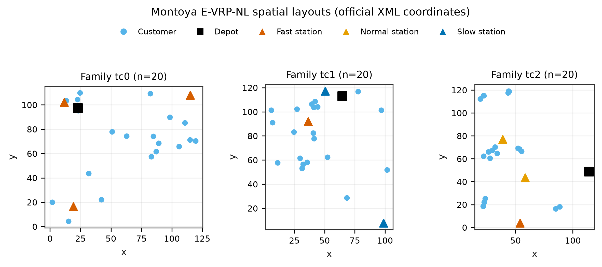

**Figure 2.** Official Montoya spatial layouts for location families tc0, tc1, and tc2 (n=20 representatives). Markers: depot (square), customers (circles), charging stations by technology (triangles). Coordinates are dataset units from the XML files.

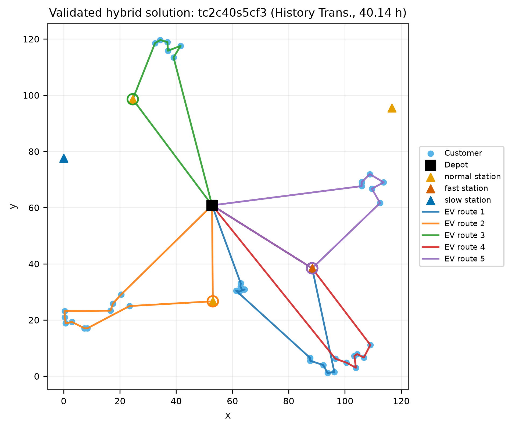

**Figure 3.** Validated hybrid solution for `tc2c40s5cf3` (History Transformer, hybrid_insert; full duration 40.14 h). Routes from saved JSON; open circles mark charge visits. Source: `results/raw/regression_recovery/solutions/`.

---

## 5. Training Methodology

The routing policy is first trained through behavior cloning of feasible solutions generated by randomized greedy construction and local search. Expert charging schedules come from an exact fixed-route nonlinear charging solver. The pretrained policy may then undergo REINFORCE fine-tuning with \(R=-Z_\mathrm{full}\) if feasible and \(R=-100\) if infeasible. Because the fixed-route optimizer is not differentiable, policy gradients use sampled routing-action log probabilities rather than gradients through `frvcpy`.

Details: `docs/TRAINING_AND_REWARD_METHODOLOGY.md`.

---

## 6. Experimental Setup

Official Montoya XML; primary multi-seed architecture eval on n=10 fair-LS (seeds 42–44); nonlinear study covers all 20 instances at n=10/20/40; recovered n=40 hybrid is single-seed; training on synthetic n=10. Metrics: feasibility, \(Z_\mathrm{full}\), \(Z_\mathrm{lit}\), charging hours, oracle counts, runtime.

---

## 7. Results — Nonlinear Charging (RQ3)

Full study: `results/NONLINEAR_CHARGING_STUDY.md`.

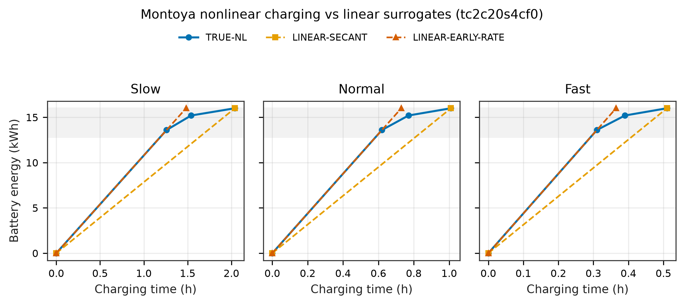

**Figure 4.** Montoya piecewise-linear charging curves versus LINEAR-SECANT and LINEAR-EARLY-RATE for slow/normal/fast technologies. Late-SOC region charging slows relative to early-rate extrapolation. Units: hours vs kWh. XML breakpoints preserved.

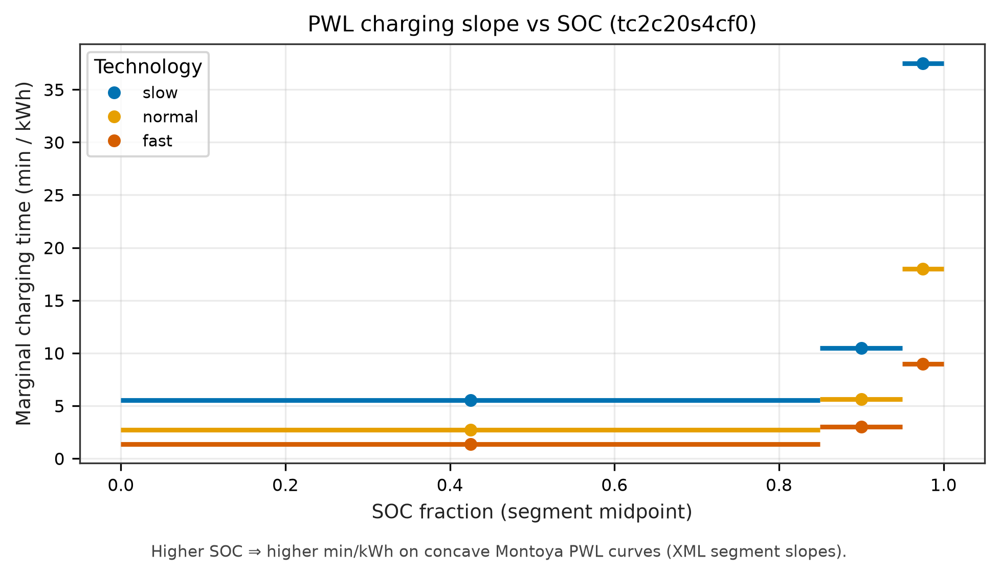

**Figure 5.** Marginal charging time (minutes per kWh) from actual PWL segment slopes versus SOC fraction. Higher SOC requires more time for the same energy increment—the physical reason linear early-rate models are optimistic.

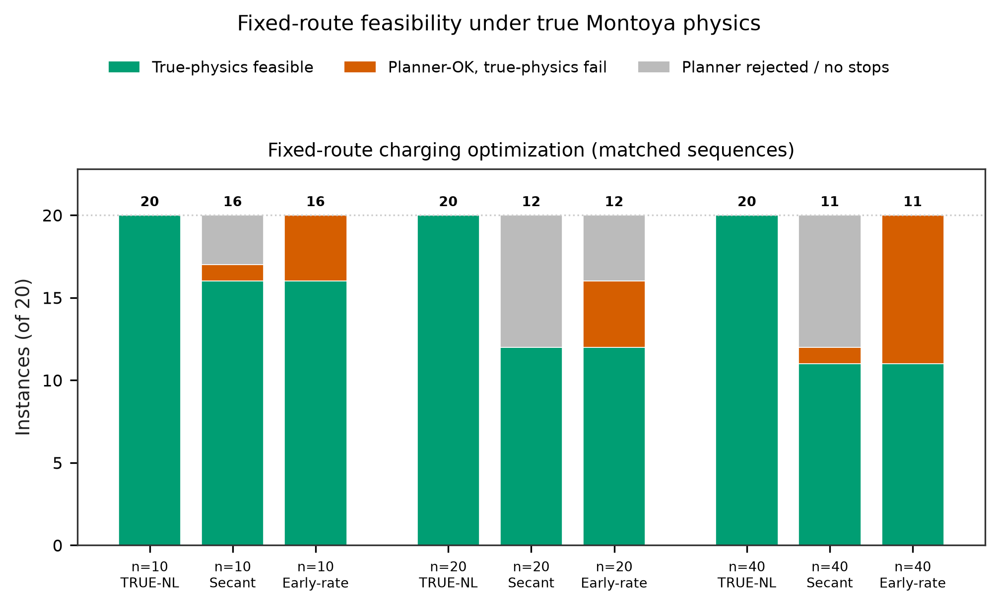

**Figure 6.** Fixed-route charging optimization on matched customer sequences (20 official instances per size). Stacked outcomes: true-physics feasible (green), planner-OK but true-physics fail (orange), planner rejected (grey). Numbers = true-feasible counts. At n=40: TRUE-NL 20/20; SECANT 11/20; EARLY 11/20—with different failure mechanisms.

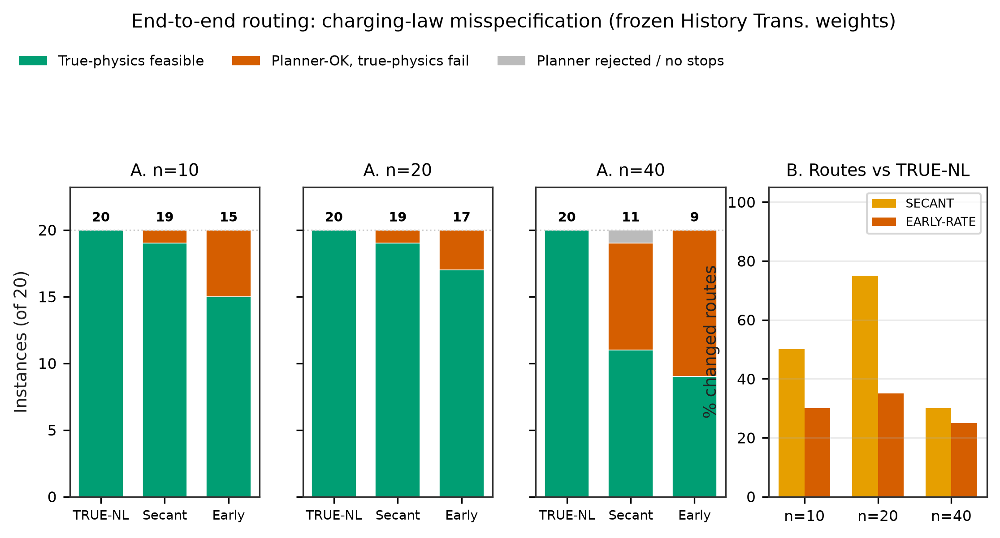

**Figure 7.** End-to-end neural routing with frozen H2 weights under different planning curves (left: true-physics feasibility; right: fraction of instances whose customer sequences change vs TRUE-NL). Unlike Figure 6, routing decisions may change. At n=40: TRUE-NL 20/20, SECANT 11/20, EARLY 9/20.

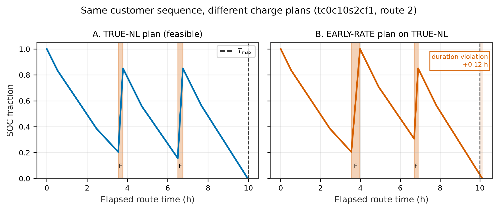

**Figure 8.** Same fixed customer sequence on `tc0c10s2cf1` (route with charges): TRUE-NL plan (left) versus LINEAR-EARLY-RATE plan replayed on true curves (right). Shaded intervals = charging; dashed line = \(T_{\max}\). The linear plan underestimates charging duration and violates the route-duration limit. Companion table: `results/tables/table_fig08_schedule_case.md`.

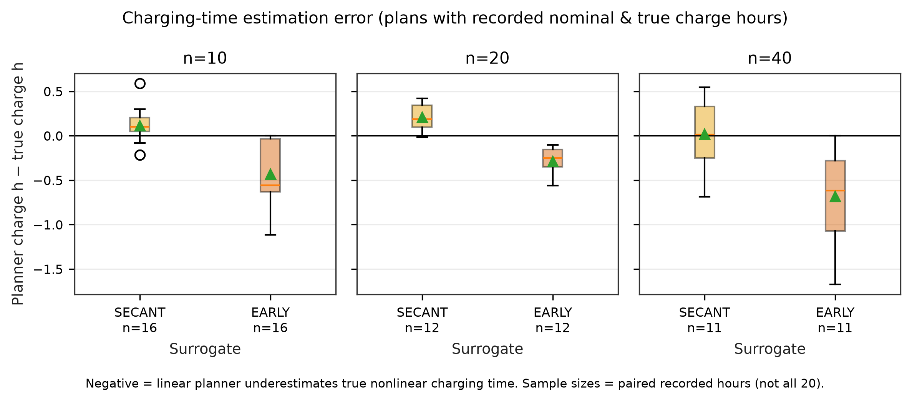

**Figure 9.** Planner-predicted charging hours minus true nonlinear charging hours for fixed-route plans with both quantities recorded. Negative values = underestimation. Sample sizes shown per panel (selected by recorded hours—not an unconditional sample of all 20).

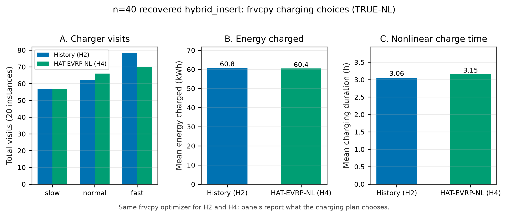

**Figure 10.** Recovered n=40 hybrid_insert (20 instances): (A) charger visits by technology, (B) mean energy charged, (C) mean nonlinear charging duration—**separate panels, no twin-axis**. Describes what `frvcpy` chooses under TRUE-NL for H2 vs H4.

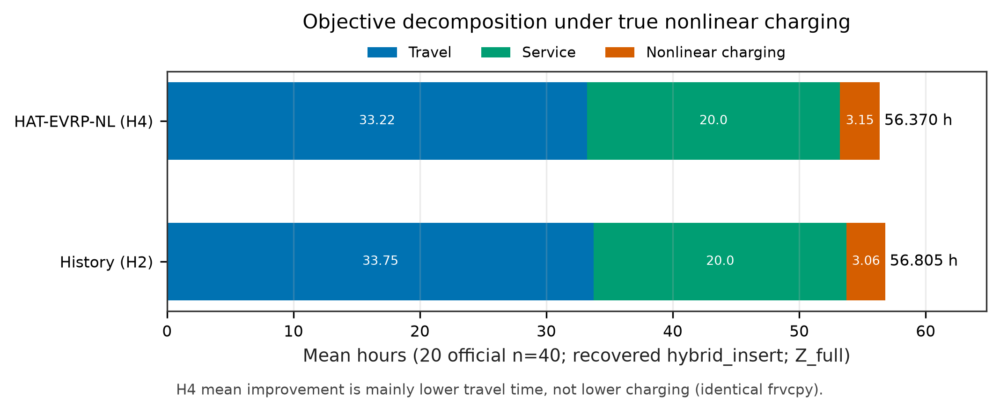

**Figure 11.** Mean travel + service + nonlinear charging for recovered n=40 hybrid_insert (20 instances). H2: 33.745 + 20.000 + 3.060 = 56.806 h; H4: 33.219 + 20.000 + 3.151 = 56.370 h. Legend outside axes. H4’s mean edge is mainly travel, not charging—both use the same `frvcpy` optimizer (not evidence that DeepSets improves the charging solver).

**Answer to RQ3.** Nonlinear charging matters: linear surrogates frequently yield planner failures or true-physics infeasibility, with rates growing in \(n\).

---

## 8. Results — Neural Routing Quality (RQ1, RQ2)

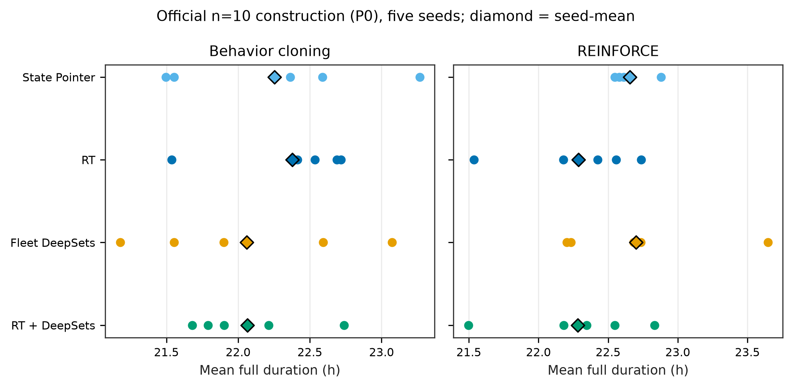

**Figure 12.** Matched n=10 Cycle-3 fair one-shot LS (20 instances × 3 seeds). Points = seed means ± std; ticks = seed means. History Transformer 19.813±0.227 h beats state-only 19.993±0.201 h and greedy+LS 20.142±0.223 h. HAT-EVRP-NL 19.886±0.156 h does not consistently beat history alone. Full duration hours.

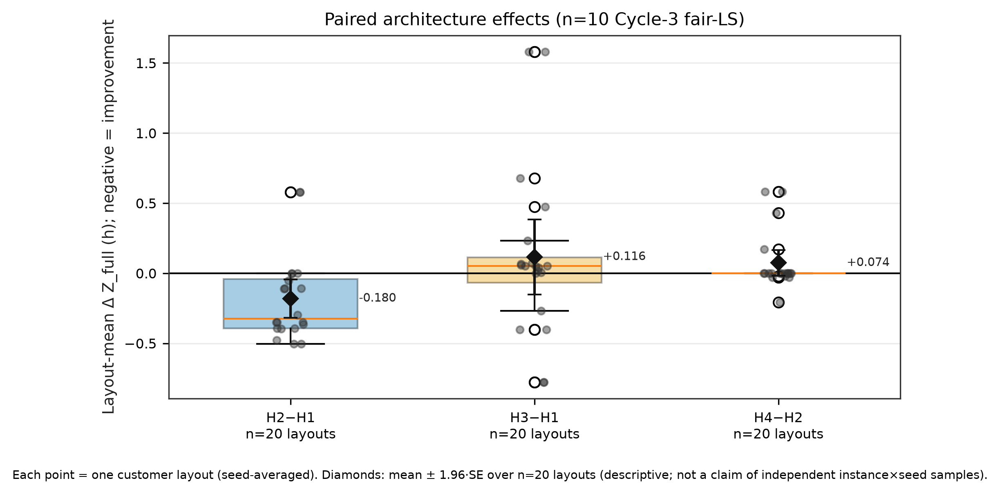

**Figure 13.** Layout-aware paired effects (n=10 Cycle-3 fair-LS): each point is one customer layout after averaging seed-level deltas; diamonds are mean ± 1.96·SE over **n=20 layouts**. Negative = improvement. Do not treat 60 instance×seed rows as 60 independent layouts. H4−H2 straddles zero—DeepSets is not a dependable paired win here.

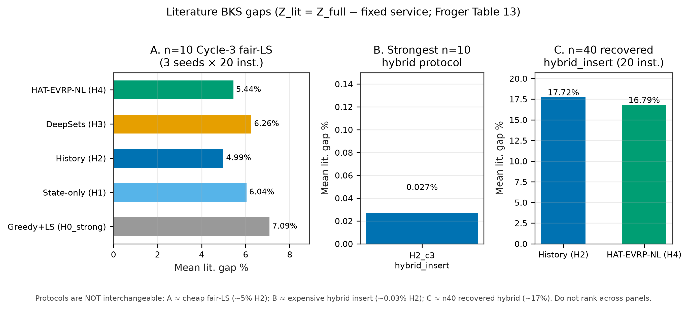

**Figure 14.** Literature BKS gaps with \(Z_\mathrm{lit}=Z_\mathrm{full}-\text{service}\) (Froger Table 13), **protocol-separated**: (A) n=10 Cycle-3 fair-LS ≈ 4.99% H2 / 5.44% H4; (B) strongest labeled n=10 hybrid_insert H2_c3 ≈ **0.027%** under a more expensive repair protocol; (C) n=40 recovered hybrid_insert ≈ **17.72% / 16.79%** (H2/H4). Panels are not interchangeable rankings. We do **not** claim state-of-the-art performance.

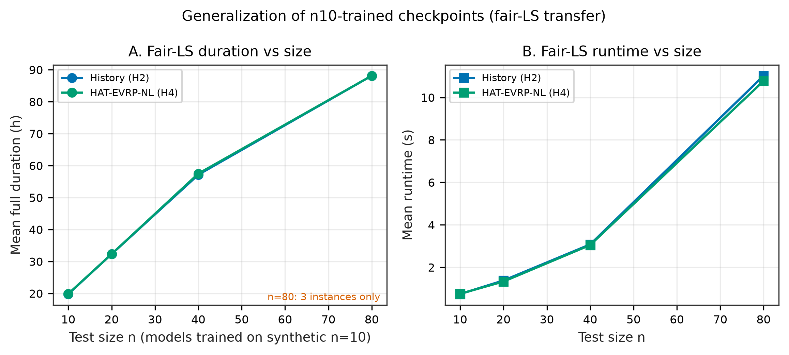

**Figure 15.** n10-trained H2/H4 transferred under fair-LS to n=10/20/40/80: mean full duration and runtime. **Warning:** n=80 uses only 3 instances. Recovered hybrid n=40 (different protocol) reaches 56.806 / 56.370 h (H2/H4).

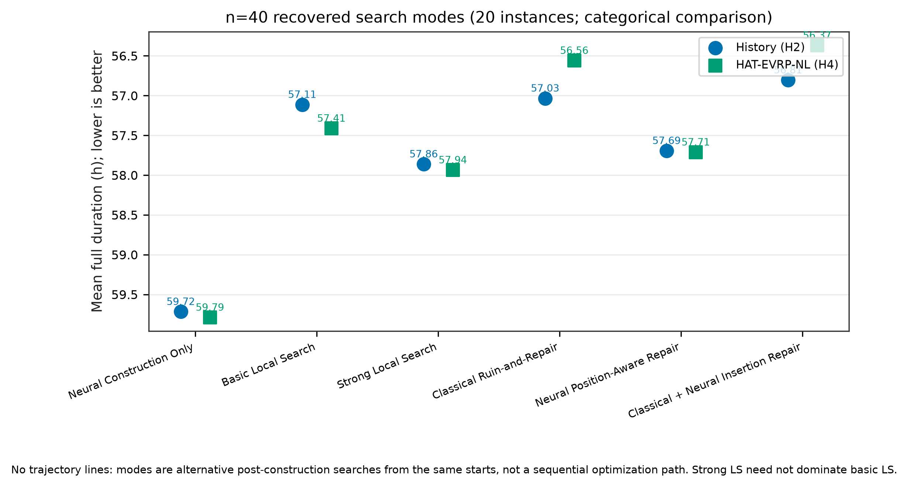

**Figure 16.** Recovered n=40 **categorical** search-mode means for H2/H4 (20 instances). Markers only—**no trajectory lines**. Modes are alternative post-construction searches from the same starts; strong LS need not dominate basic LS. Hybrid insert has the best mean among reported modes but is not an equal-budget claim.

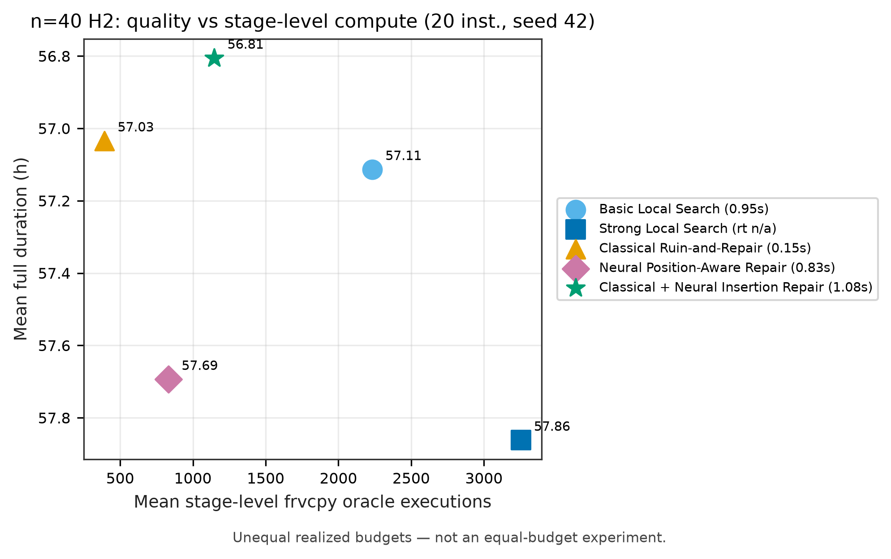

**Figure 17.** n=40 H2: mean full duration versus mean stage-level `frvcpy` oracle executions (20 instances, seed 42). Legend outside plot; runtimes where measured. **Unequal realized budgets—not an equal-budget experiment.** Do not claim hybrid search is more efficient.

---

## 9. Results — Learning and Reward (RQ4)

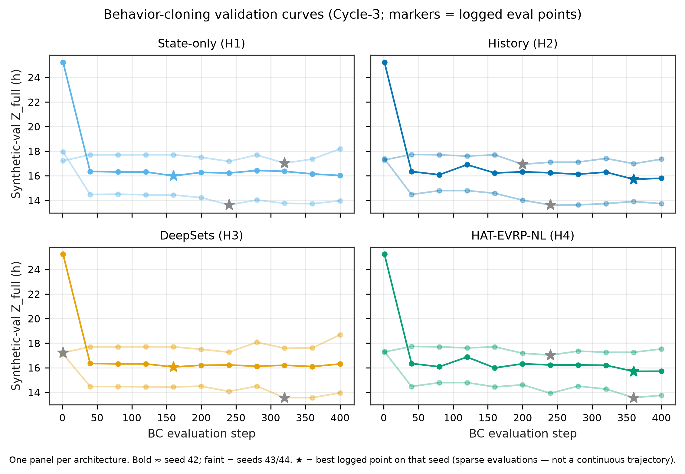

**Figure 18.** Cycle-3 behavior-cloning synthetic-validation objective in **separate architecture panels** at logged evaluation steps (not continuous interpolation). Bold ≈ seed 42; faint = 43/44; ★ = best logged point per seed.

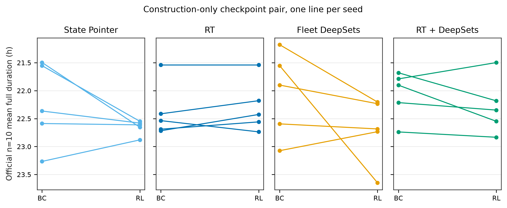

**Figure 19.** Controlled RQ4 paired slopes: BC-only → RL-from-BC mean full duration on official n=10 **construction-only** (20/20 feasible). H2: RL better on 1/3 seeds; H4: 3/3. This is **not** proof that RL improves final hybrid routing. Distinct from historical Cycle-3 synthetic-validation RL endpoints (H4 often worse than best BC).

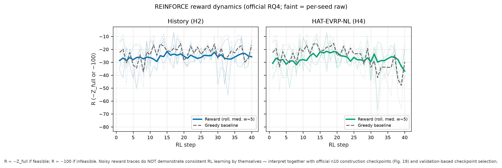

**Figure 20.** Actual REINFORCE rewards from `reward_*_rl_from_bc_rq4.csv`. \(R=-Z_\mathrm{full}\) if feasible, else \(-100\). Faint = seeds; bold = mean rolling median (window=5); dashed = greedy baseline. **Noisy traces do not by themselves demonstrate consistent RL learning**—interpret with Figure 19 checkpoint outcomes and validation-based selection.

Supplementary diagnostic (not a main-paper claim figure): `results/supplementary/figures/fig21_rl_training_stability.png` (gradient norm, advantage, entropy, PG loss; correlational only).

Across Cycle-3 training seeds, RL endpoints do not consistently improve over best BC validation—especially H4 (0/3). Deployed checkpoints use validation selection.

---

## 10. Ablations and Limitations

History helps on matched n=10 fair-LS; DeepSets lacks consistent gain; linear charging assumptions harm true-physics feasibility; frvcpy hybrid ≫ direct learned charging (4/20 vs 20/20 on tested n=10); post-search ≠ architecture; RL gains are protocol-dependent; n=40 hybrid is single-seed / unequal compute; n=80 thin.

---

## 11. Conclusion

| RQ | Answer |
|---|---|
| RQ1 | Yes under Cycle-3 fair-LS n=10 (history vs state-only). |
| RQ2 | No consistent DeepSets gain over history on matched n=10. |
| RQ3 | Yes—linear surrogates often fail true Montoya physics. |
| RQ4 | Protocol-dependent; do not claim RL always improves deployed Cycle-3 H4. |

---

## Manuscript figure index (20 main + 1 supplementary diagnostic)

| Fig | File |
|---|---|
| 1 | `results/figures/fig01_hat_evrp_nl_architecture.png` |
| 2 | `results/figures/fig02_montoya_instance_layouts.png` |
| 3 | `results/figures/fig03_feasible_ev_routes.png` |
| 4 | `results/figures/fig04_nonlinear_charging_curves.png` |
| 5 | `results/figures/fig05_charging_time_vs_soc.png` |
| 6 | `results/figures/fig06_fixed_route_charging_feasibility.png` |
| 7 | `results/figures/fig07_end_to_end_charging_feasibility.png` |
| 8 | `results/figures/fig08_soc_charging_schedule.png` |
| 9 | `results/figures/fig09_linear_charging_estimation_error.png` |
| 10 | `results/figures/fig10_station_usage_and_energy.png` |
| 11 | `results/figures/fig11_objective_decomposition.png` |
| 12 | `results/figures/fig12_neural_architecture_ablation.png` |
| 13 | `results/figures/fig13_history_deepsets_paired_effect.png` |
| 14 | `results/figures/fig14_literature_bks_gap.png` |
| 15 | `results/figures/fig15_generalization_scalability.png` |
| 16 | `results/figures/fig16_search_improvement_stages.png` |
| 17 | `results/figures/fig17_quality_vs_compute.png` |
| 18 | `results/figures/fig18_behavior_cloning_learning_curves.png` |
| 19 | `results/figures/fig19_bc_vs_rl_checkpoint_quality.png` |
| 20 | `results/figures/fig20_reinforce_reward_dynamics.png` |
| Supp. | `results/supplementary/figures/fig21_rl_training_stability.png` |

Catalog: `docs/FIGURE_CATALOG.md`. Supplementary: `results/supplementary/figures/`.

---

## References (selected)

1. Montoya et al. (2017). https://doi.org/10.1016/j.trb.2017.02.004  
2. Froger et al. (2022). https://doi.org/10.1287/trsc.2021.1111  
3. Kool et al. (2019). https://arxiv.org/abs/1803.08475  
4. Kwon et al. (2020). https://arxiv.org/abs/2010.16011  
5. Kullman et al. (2021). https://doi.org/10.1287/ijoc.2020.1035  
