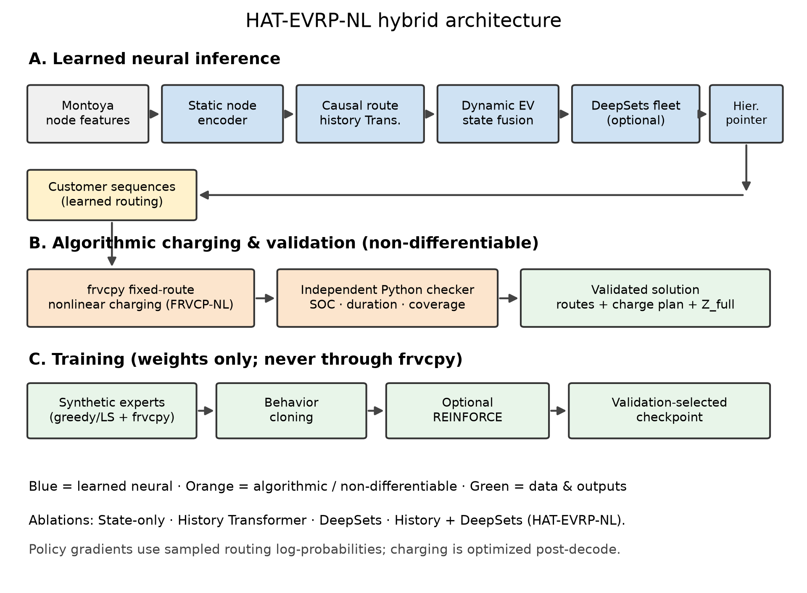
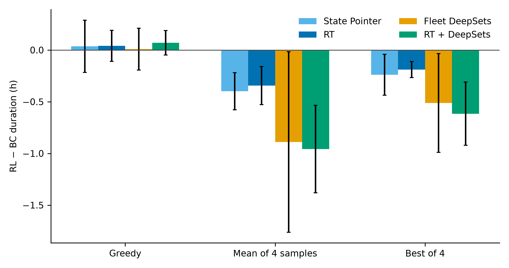
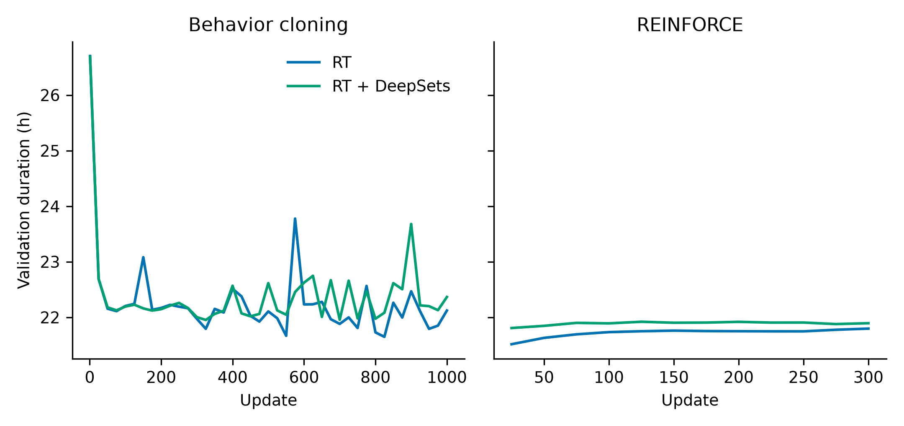
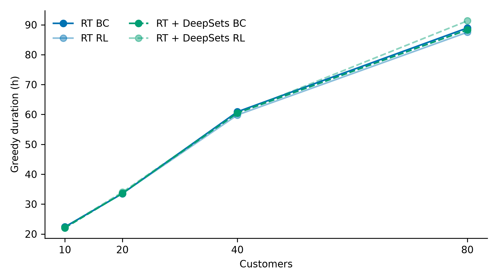
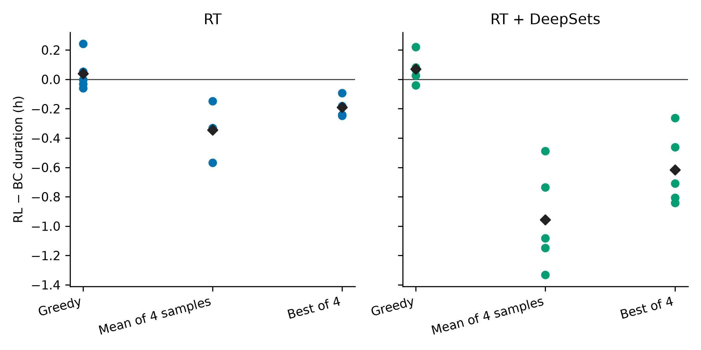
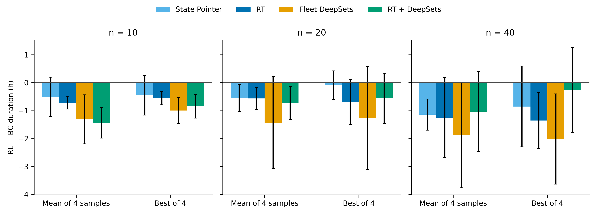
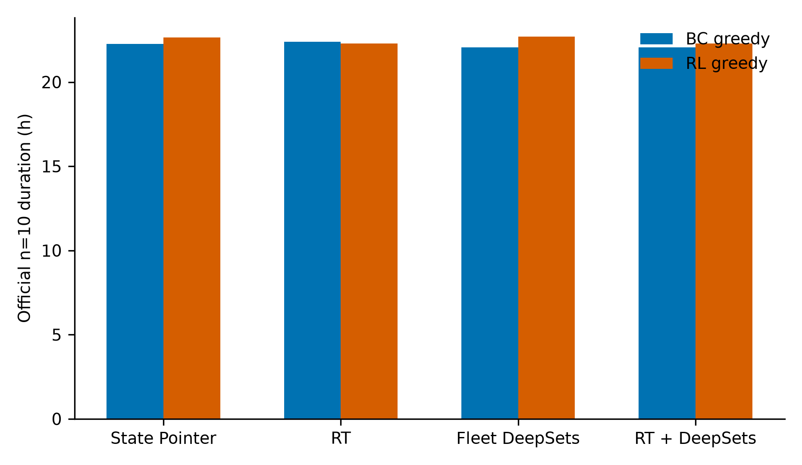
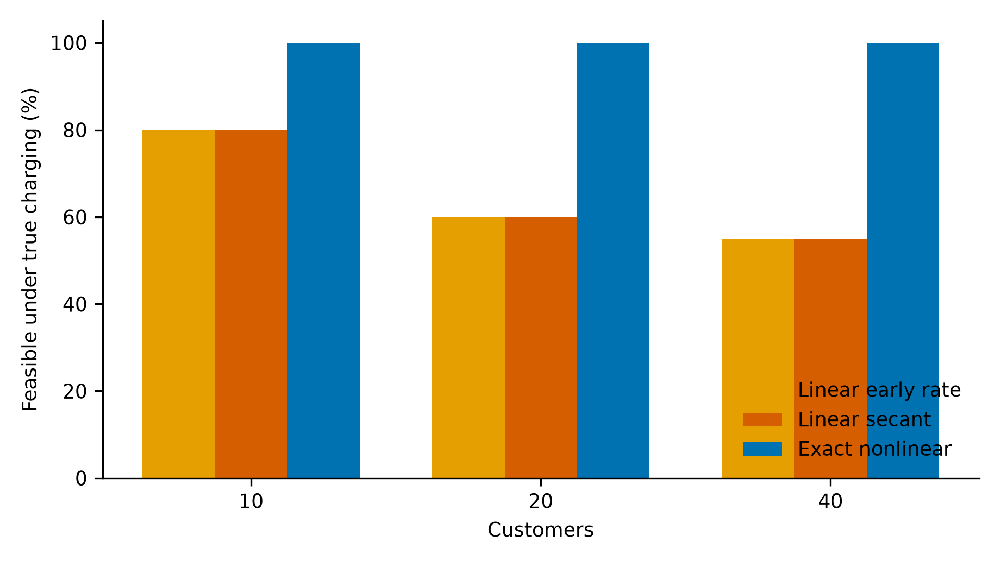

# Neural Electric Vehicle Routing with Nonlinear Charging: Behavior Cloning and Reinforcement Learning

**HAT-EVRP-NL**

Branch `bc-rl-v1`. Raw tables: `results/tables/final/`. Figures: `results/final/figures/`. The fixed-route charging optimizer is `frvcpy` (Kullman et al., 2021). This paper does not claim to have invented it.

---

## Abstract

HAT-EVRP-NL is a neural constructor for the electric vehicle routing problem with nonlinear charging. The policy learns route choice and customer order. Charging stations and charge amounts are not network outputs. After a customer sequence is chosen, `frvcpy` solves the fixed-route charging problem on the station-specific Montoya curves, and an independent checker tests state of charge, coverage, duration, and charging time. Training has two phases and no others: behavior cloning, then REINFORCE.

On the shared synthetic validation set, REINFORCE does not improve greedy construction. Every paired 95% interval for greedy duration includes zero. The same checkpoints do improve the sampling distribution that REINFORCE optimizes. For the original Route Transformer, the mean duration of four independent samples falls by 0.344 h, interval [−0.528, −0.160], on 5 of 5 seeds. The best of those four samples falls by 0.189 h, interval [−0.267, −0.112], also on 5 of 5 seeds. Every sampled trajectory in this comparison is feasible.

That split survives the official Montoya instances when the inference protocol is frozen before looking at them. Greedy construction remains inconclusive: the Route Transformer changes by −0.091 h at n=10, interval [−0.336, +0.154]. The mean of four samples improves for the Route Transformer by 0.714 h at n=10 and 0.566 h at n=20, and both intervals lie below zero. The same mean-sample result holds for Route Transformer + DeepSets at those two sizes. At n=40 the Route Transformer mean-sample interval includes zero. Best-of-four is established at n=10 for both architectures and at n=40 for the Route Transformer; it is not established at n=20. Four samples cost about four times as many charging solves as one greedy construction, and the best sample is still not better than the greedy Route Transformer construction. The supported claim is narrower than “reinforcement learning improves the deployed route”: it improves expected sampled construction, not the single greedy route.

---

## 1. Introduction

Montoya et al. (2017) define the electric vehicle routing problem with nonlinear charging. A route may detour to a station whose charging time is a piecewise-linear function of state of charge, and each route has a maximum duration. Froger et al. (2021) publish the best known solutions used here. Kullman et al. (2021) provide the fixed-route solver that turns a customer sequence into a feasible charging plan.

The neural policy does not replace that solver. It chooses which route to extend and which customer to append. The scientific question is whether a second training phase, REINFORCE, improves that constructor relative to behavior cloning when both are scored with the same exact charging optimizer.

Four questions are answered with paired five-seed comparisons. A negative duration difference means the REINFORCE checkpoint is faster.

**RQ1.** Does REINFORCE lower greedy construction duration?

**RQ2.** Does REINFORCE lower the mean, and the best, of four sampled constructions when behavior cloning receives the same four random seeds and the same charging solver?

**RQ3.** Do linear charging surrogates remain feasible when the resulting plan is checked on the true station curves?

**RQ4.** Does adding Fleet DeepSets to the Route Transformer improve construction over the Route Transformer alone?

Five seeds share one synthetic training set. The intervals measure initialization and sampling noise, not a new draw of the training data. Official instances are not used to choose checkpoints or the inference protocol.

---

## 2. Related work

Kool, van Hoof, and Welling (2019) train an attention model for routing with REINFORCE and a greedy-rollout baseline. Kwon et al. (2020) exploit several optimal trajectories per instance and compare inference budgets. This project does not implement POMO. It does compare one greedy decode with four independent samples from the same policy. Rennie et al. (2017) use the greedy test-time decode as a detached baseline for the policy gradient. That baseline is implemented here and was not the baseline of the runs reported below. Those runs use a leave-one-out baseline. A further training configuration that combines the greedy baseline with a lower learning rate was specified and then not launched, because the validation audit already met its stopping rule.

Montoya et al. (2017) and Froger et al. (2021) define the physical problem and the reference solutions. Kullman et al. (2021) define the fixed-route charging solver. None of those results imply that REINFORCE must improve a behavior-cloned routing policy.

---

## 3. Problem and charging

An instance has a depot, customers, and charging stations. A solution is a set of routes. Each route starts and ends at the depot, serves each of its customers once, and may insert stations. The full duration is

\[
Z_{\mathrm{full}} = \text{travel} + \text{service} + \text{nonlinear charging}.
\]

The literature objective used for best-known-solution gaps removes service time. Charging time on a station curve \(C_s\) between incoming energy \(q_{\mathrm{in}}\) and outgoing energy \(q_{\mathrm{out}}\) is

\[
\text{charging time} = C_s(q_{\mathrm{out}}) - C_s(q_{\mathrm{in}}).
\]

\(C_s\) is the piecewise-linear cumulative curve of that station. A solution is accepted only if every customer is served once, every route respects the battery and the duration limit, and the charging times match the station curves. Linear early-rate and linear secant planners appear only in the sensitivity study. They are not the reward or the reported constructor.

---

## 4. Policy

The constructor is a hierarchical pointer. It does not output a charge. At each decision it scores the open routes and the option to open a new route, then scores the unserved customers and, when a route is already open, the option to close it. Infeasible actions are masked. The Route Transformer (RT) encodes the stop sequence of the current route, including charging features taken from the current `frvcpy` plan. A causal mask limits attention along that sequence. It does not mean that every token was a committed neural action. Fleet DeepSets is an optional permutation-invariant fleet aggregator. The four trained configurations are State Pointer, Route Transformer, Fleet DeepSets, and Route Transformer + DeepSets. The last of these is the full HAT-EVRP-NL model. Internal checkpoint keys remain H1–H4.

**Figure 1.** The policy selects routes and customers. `frvcpy` inserts stations and charge amounts for the fixed customer sequence.

---

## 5. Training

Behavior cloning imitates feasible customer sequences from randomized greedy construction and local search. For a teacher trajectory \(\tau\),

\[
L_{\mathrm{BC}} = -\frac{1}{|\tau|}\sum_{t\in\tau}\log\pi_\theta(a_t\mid s_t),
\]

where \(a_t\) is a route choice followed by a customer or close choice,

\[
\pi_\theta(a\mid s)=\pi_\theta(r\mid s)\,\pi_\theta(c\mid r,s).
\]

REINFORCE then draws \(K=4\) trajectories from the live policy on a training instance. The normalized reward of a feasible trajectory is

\[
R = -Z_{\mathrm{full}}/(n\,T_{\max}).
\]

An infeasible trajectory scores below \(-1\). In the recorded runs the infeasible penalty does not fire: the audited samples are feasible. The advantage of a sample is its reward minus the mean reward of the other three samples. The baseline is a Python float, so it does not carry a gradient. The loss is the mean of \(-\,A\log\pi_\theta(\tau)\) over the four samples. Entropy regularization is zero. Gradients are clipped at norm 1. The learning rate is \(5\times 10^{-5}\). Checkpoint selection, during training, is greedy validation duration. It is not the sampled objective.

A distribution penalty toward the frozen behavior-cloning policy was studied separately. The customer term in that penalty is conditional on the route the live policy already selected. It is not the expectation of the customer KL under the route distribution, so it is a sampled-conditional regularizer rather than the exact KL of the hierarchical policy. Those runs are not the locked comparison. The locked checkpoints are the original leave-one-out runs.

---

## 6. Experimental setup

The original matrix is four architectures and seeds 42–46. All twenty runs finish 1,000 behavior-cloning updates and 300 REINFORCE updates. They share 500 synthetic training instances and 100 validation instances, data seed 1000, generator v2, \(n=10\). Behavior-cloning and REINFORCE checkpoints are stored separately. Deployment may keep the behavior-cloning weights when greedy validation does not improve. The tables below still score the REINFORCE checkpoint.

The validation audit, frozen before it was run, scores three protocols on those 100 instances: one greedy decode, the mean duration of four samples, and the best feasible sample among those four. Sample \(k\) of instance \(i\) uses torch seed \(910000 + 16i + k\), for every checkpoint. Infeasible decodes would count as \(n T_{\max}\). None did. A credible benefit required a lower duration on at least 4 of 5 seeds and a Student-t 95% interval of the paired differences entirely below zero. Greedy did not meet that rule for any saved experiment. The mean of four samples and the best of four did, for every architecture in the original matrix. The stopping rule then forbids another training configuration. The prepared greedy-baseline run at learning rate \(2\times 10^{-5}\) was not started.

Official evaluation uses the 20 Montoya instances at each size. Greedy numbers are the existing construction-only protocol. Sampled numbers use the same four seeds. n=10 and n=20 were required. n=40 was completed with the same protocol after those two sizes. n=80 sampled construction was not run. Greedy n=80 remains the earlier construction-only evaluation. No local search, ruin-and-repair, or hybrid insertion enters these numbers. Those procedures remain in the supplementary evaluation files and are not evidence about reinforcement learning.

---

## 7. Greedy construction

**Figure 2.** Synthetic validation. Each bar is the mean paired difference, RL minus BC, with the 95% interval. Negative means the REINFORCE checkpoint has the lower duration.

**Figure 3.** Mean greedy validation duration across five seeds. Both panels use the same vertical scale. Behavior cloning reduces duration. REINFORCE does not.

On the original checkpoints, greedy validation differences are +0.036 h (State Pointer), +0.040 h (Route Transformer), +0.009 h (Fleet DeepSets), and +0.070 h (Route Transformer + DeepSets). Seeds better than behavior cloning are 2, 3, 1, and 1 of 5. Every interval includes zero. Feasibility is 1.0.

Official greedy construction agrees. At n=10 the Route Transformer moves from 22.379 h to 22.287 h, a paired difference of −0.091 h, interval [−0.336, +0.154], better on 3 of 5 seeds. Route Transformer + DeepSets moves from 22.065 h to 22.282 h, interval [−0.241, +0.676]. No greedy interval at n=10, 20, 40, or 80 excludes zero. Feasibility is 1.0 at every size. The n=10 literature gaps of the Route Transformer, against Froger et al. (2021) Table 13, are 23.4% after behavior cloning and 22.7% after REINFORCE. That is not a state-of-the-art claim.

**RQ1.** Not established. Greedy construction does not reliably improve.

**Figure 4.** Official greedy duration at n=10, 20, 40, and 80. Markers are the measured sizes.

---

## 8. Sampled construction

The same checkpoints, the same instances, and the same four seeds give a different answer. On synthetic validation the original Route Transformer mean sample falls from 25.168 h to 24.824 h (−0.344 h, interval [−0.528, −0.160], 5/5 seeds). Its best of four falls from 22.559 h to 22.370 h (−0.189 h, interval [−0.267, −0.112], 5/5). Route Transformer + DeepSets falls by 0.958 h on the mean and 0.616 h on the best of four, both on 5 of 5 seeds, and both intervals exclude zero. Shuffled-order and distribution-penalty reruns show the same pattern. They were not used to choose the protocol.

**Figure 5.** One point is one seed. The diamond is the five-seed mean. Original checkpoints only.

Official instances confirm the mean-sample result for the two primary architectures.

| Model | Size | BC mean of 4 (h) | RL mean of 4 (h) | Difference (h) | Seeds better | 95% interval |
|---|---:|---:|---:|---:|---:|---|
| Route Transformer | 10 | 26.232 | 25.518 | −0.714 | 5/5 | [−0.944, −0.484] |
| Route Transformer | 20 | 42.524 | 41.958 | −0.566 | 5/5 | [−0.965, −0.166] |
| RT + DeepSets | 10 | 26.798 | 25.366 | −1.432 | 5/5 | [−1.983, −0.882] |
| RT + DeepSets | 20 | 42.574 | 41.836 | −0.738 | 5/5 | [−1.328, −0.148] |

Best-of-four is established at n=10: Route Transformer −0.556 h, interval [−0.794, −0.318], 5/5 seeds; RT + DeepSets −0.849 h, interval [−1.266, −0.432], 5/5. At n=20 both best-of-four intervals include zero. At n=40 the Route Transformer mean of four samples is −1.251 h on 5 of 5 seeds, but the interval [−2.677, +0.176] includes zero, so that transfer is not established. Its best of four at n=40 is −1.356 h, interval [−2.363, −0.348], 5/5. RT + DeepSets at n=40 has intervals that include zero for both the mean and the best of four. Every official sample in these cells is feasible.

The four samples are not a substitute for greedy decoding. At official n=10 the Route Transformer greedy behavior-cloning duration is 22.379 h. Its best of four samples is 23.085 h before REINFORCE and 22.529 h after. The REINFORCE best-of-four still does not beat the single greedy behavior-cloning route, and it uses 3,971 charging-solver executions across the 20 instances against 1,100 for greedy. The sampled gain is real at a matched sample budget. It is not a better deployment policy than greedy construction.

**Figure 6.** Official paired differences for four-sample inference. Intervals that cross zero are not counted as established.

**RQ2.** Yes for the mean of four samples, on the Route Transformer and on RT + DeepSets, at official n=10 and n=20. That mean-sample interval includes zero at n=40 for both architectures. Best-of-four is established at n=10 for both, and at n=40 for the Route Transformer only. Greedy decoding remains the stronger single construction.

Checkpoint selection did not look at these sampled numbers. The REINFORCE file is the best greedy-validation checkpoint.

---

## 9. Route Transformer and DeepSets

**Figure 7.** Official n=10 greedy duration. Behavior cloning and REINFORCE are separate bars.

At official n=10, greedy behavior-cloning means are 22.253 h (State Pointer), 22.379 h (Route Transformer), 22.060 h (Fleet DeepSets), and 22.065 h (RT + DeepSets). The Route Transformer is not better than the State Pointer. Adding DeepSets does not produce a paired improvement that this study treats as established: the n=80 greedy REINFORCE mean for RT + DeepSets is 91.318 h against 88.311 h for its own behavior-cloning checkpoint, and that interval includes zero. The sampled-mean gain in Section 8 appears in both the Route Transformer and RT + DeepSets, so it is not an effect that requires DeepSets.

**RQ4.** Not established.

---

## 10. Nonlinear charging

**Figure 8.** Fixed customer routes. Each bar is the fraction of 20 official instances whose plan remains feasible on the true station curves. Source: `results/raw/nonlinear_charging/charging_study_summary.csv`.

Exact nonlinear plans are feasible on 20 of 20 instances at n=10, 20, and 40. The linear early-rate plan is feasible under true physics on 16, 12, and 11 of 20. The linear secant plan matches those counts in this summary. A linear plan can therefore look acceptable to its own planner and still violate Montoya charging. The constructor reported in this paper never uses that surrogate as its objective.

**RQ3.** Yes. Exact station curves are required for the feasibility claim.

---

## 11. Limitations

The five seeds share one synthetic training set. Intervals are not a confidence statement about a new training distribution. Picking the best of four samples and reporting it as one greedy decode would misstate the inference budget; this paper keeps them separate. The mean-sample improvement does not keep an interval below zero at n=40. The customer KL used in an earlier penalty is conditional on the selected route, and that penalty is not the result in Sections 7 and 8. n=80 was not evaluated under four-sample decoding. Classical ruin-and-repair and hybrid insertion can lower duration further. Their files remain in `results/raw/bc_rl_full_v1/eval` under protocols P1 and P2, and they are not used as evidence that REINFORCE improved the constructor.

---

## 12. Conclusion

Behavior cloning learns a feasible neural constructor whose charging plans come from an exact fixed-route solver. REINFORCE, from those checkpoints, does not establish a better greedy route. It does establish a better sampling distribution at n=10 and n=20: under a matched budget of four trajectories, the mean sample is shorter on the official instances for both the Route Transformer and Route Transformer + DeepSets, with intervals below zero and no infeasible sample. That mean-sample interval includes zero at n=40. The best of four samples is established at n=10 for both architectures and at n=40 for the Route Transformer. A single greedy decode remains the better construction. Linear charging surrogates are often infeasible under the true station curves, so the exact solver is part of the result rather than a replaceable subroutine.

---

## References

Froger, A., Mendoza, J. E., Jabali, O., and Laporte, G. (2021). Improved formulations and algorithmic components for the electric vehicle routing problem with nonlinear charging functions. *Computers & Operations Research*. Best known solutions: Table 13.

Kool, W., van Hoof, H., and Welling, M. (2019). Attention, learn to solve routing problems! *International Conference on Learning Representations*. arXiv:1803.08475.

Kullman, N. D., Froger, A., Mendoza, J. E., and Goodson, J. C. (2021). frvcpy: An open-source solver for the fixed route vehicle charging problem. *INFORMS Journal on Computing*, 33(4). doi:10.1287/ijoc.2020.1035.

Kwon, Y.-D., Choo, J., Kim, B., Yoon, I., Gwon, Y., and Min, S. (2020). POMO: Policy optimization with multiple optima for reinforcement learning. *Advances in Neural Information Processing Systems*. arXiv:2010.16011.

Montoya, A., Guéret, C., Mendoza, J. E., and Villegas, J. G. (2017). The electric vehicle routing problem with nonlinear charging function. *Transportation Research Part B*, 103, 87–110. doi:10.1016/j.trb.2017.02.004.

Rennie, S. J., Marcheret, E., Mroueh, Y., Ross, J., and Goel, V. (2017). Self-critical sequence training for image captioning. *IEEE Conference on Computer Vision and Pattern Recognition*. arXiv:1612.00563.
