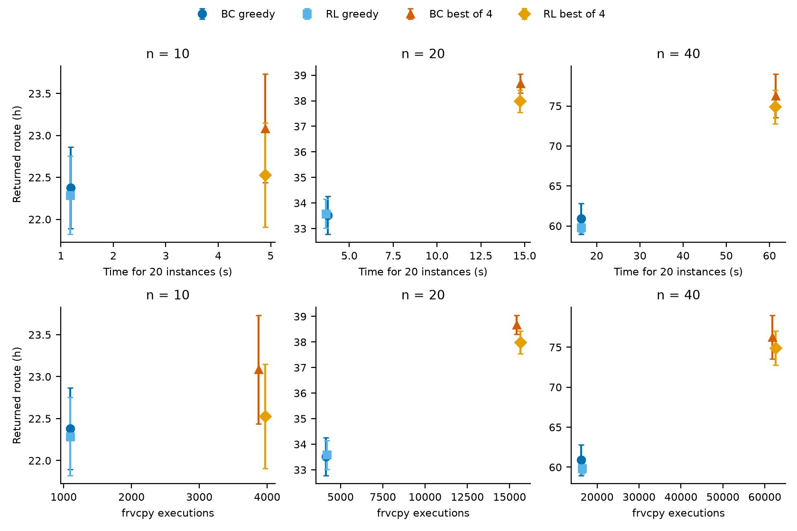
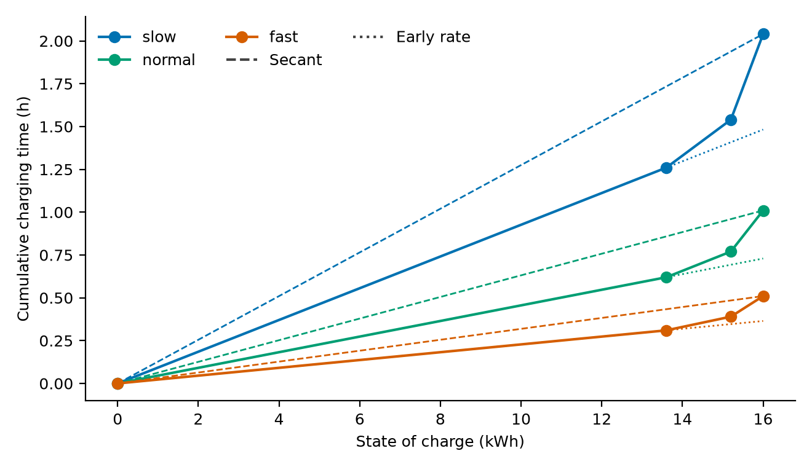
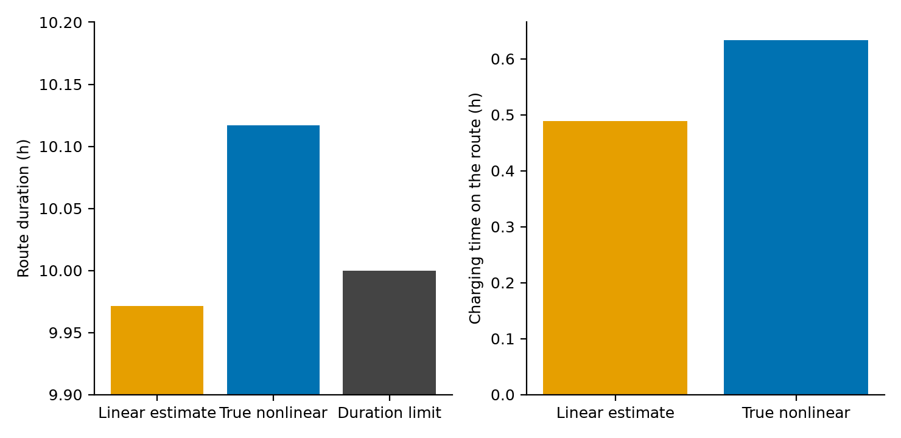
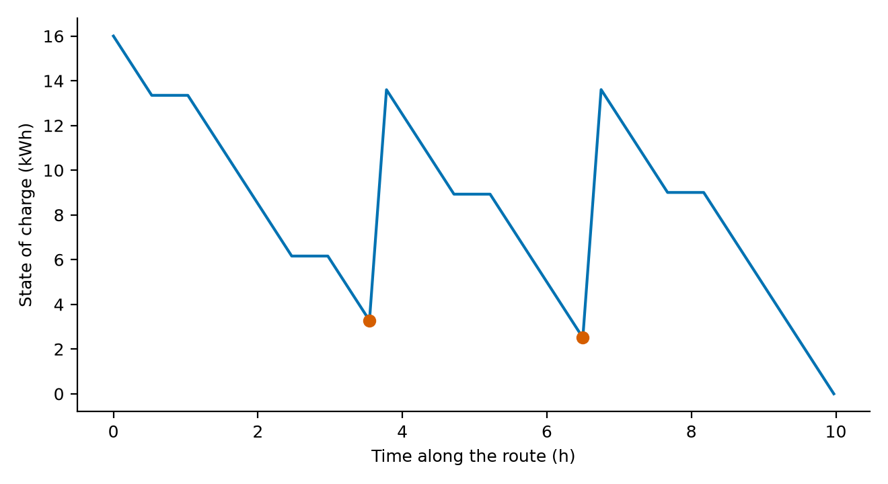
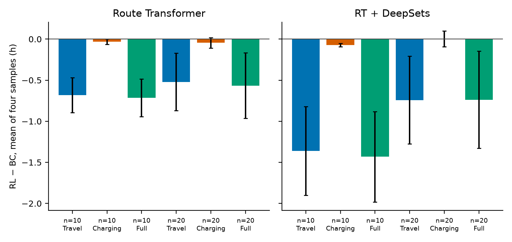

# Neural Electric Vehicle Routing with Nonlinear Charging: Behavior Cloning and Reinforcement Learning

**HAT-EVRP-NL**

The locked evaluation is commit `7671f6411a37666212656121d02a7c3af41ce1f7`. This manuscript’s charging decomposition is the following commit, on both `main` and `bc-rl-v1`. Raw tables: `results/tables/final/`. Figures: `results/final/figures/`. The fixed-route charging optimizer is `frvcpy` (Kullman et al., 2021). This paper does not claim to have invented it.

---

## Abstract

HAT-EVRP-NL is a neural constructor for the electric vehicle routing problem with nonlinear charging. The policy learns route choice and customer order. Charging stations and charge amounts are not network outputs. After a customer sequence is chosen, `frvcpy` solves the fixed-route charging problem on the station-specific Montoya curves, and an independent checker tests state of charge, coverage, duration, and charging time. Training has two phases and no others: behavior cloning, then REINFORCE.

On the shared synthetic validation set, REINFORCE does not improve greedy construction. Every paired 95% Student-t interval for greedy duration includes zero. For the original Route Transformer, the mean duration of four independent samples falls by 0.344 h, interval [−0.528, −0.160], on 5 of 5 seeds. That mean estimates one stochastic draw. The best of those four samples falls by 0.189 h, interval [−0.267, −0.112], also on 5 of 5 seeds. Every sampled trajectory in this comparison is feasible. The same five-seed sign-test limit applies to the validation comparison: 5 of 5 has two-sided sign-test p = 0.0625.

That split survives the official Montoya instances when the inference protocol is frozen before looking at them. Greedy construction remains inconclusive: the Route Transformer changes by −0.091 h at n=10, interval [−0.336, +0.154]. The mean of four independent draws is shorter for the Route Transformer by 0.714 h at n=10 and 0.566 h at n=20. Those two numbers estimate the expected duration of one stochastic draw. They are not the duration of a route that was returned to a user. The paired Student-t intervals lie below zero, and the two-sided t-tests stay below 0.05 after Holm correction for these two comparisons. The exact two-sided sign test and the exact Wilcoxon signed-rank test both give p = 0.0625. Holm adjustment of those two nonparametric tests gives 0.125. Five improvements out of five therefore do not, by themselves, establish two-sided significance at 5%. Best-of-four is a different object: it returns one selected route and spends four decodes. It is not a better deployment policy than greedy construction. A separate slow-charger holdout, fixed before evaluation, does not reproduce the sampled-mean reduction.

The same routes are scored with the original station curves. On fixed customer sequences, exact nonlinear plans stay feasible on 20 of 20 official instances at n=10, 20, and 40. Linear early-rate and linear secant plans, checked on those same curves, stay feasible on 16, 12, and 11 of 20. A saved early-rate plan for `tc0c10s2cf1` finishes in 9.971 h under its own estimate and in 10.117 h under the true curve, above the 10 h limit. The difference is charging time, 0.488 h versus 0.634 h. The early-rate line keeps the steep first segment, while the true curve is slower near a full battery, so the same energy increment takes longer.

---

## 1. Introduction

Montoya et al. (2017) define the electric vehicle routing problem with nonlinear charging. A route may detour to a station whose charging time is a piecewise-linear function of state of charge, and each route has a maximum duration. Froger, Mendoza, Jabali, and Laporte (2019) give formulations and fixed-route charging algorithms for that problem. The reference objectives used for gaps are taken from that 2019 article. They are not a verified current best-known set. Kullman et al. (2021) provide the fixed-route solver that turns a customer sequence into a feasible charging plan.

The neural policy does not replace that solver. It chooses which route to extend and which customer to append. The scientific question is whether a second training phase, REINFORCE, improves that constructor relative to behavior cloning when both are scored with the same exact charging optimizer.

Four questions are answered with paired five-seed comparisons. A negative duration difference means the REINFORCE checkpoint is faster.

**RQ1.** Does REINFORCE lower greedy construction duration?

**RQ2.** Does REINFORCE lower the mean, and the best, of four sampled constructions when behavior cloning receives the same four random seeds and the same charging solver?

**RQ3.** Do linear charging surrogates remain feasible when the resulting plan is checked on the true station curves?

**RQ4.** Does adding Fleet DeepSets to the Route Transformer improve construction over the Route Transformer alone?

Five seeds share one synthetic training set. The intervals measure initialization and sampling noise, not a new draw of the training data. Official instances are not used to choose checkpoints or the inference protocol.

---

## 2. Related work

The comparison below separates problem variants. A shared phrase, nonlinear charging, does not make two papers numerically comparable.

| Study | Variant | Charging | Routing | Charging decision | Learning | What this paper takes from it |
|---|---|---|---|---|---|---|
| Montoya et al. (2017) | E-VRP-NL, no time windows, homogeneous fleet | Piecewise-linear station curves | Classical heuristic | Charging decisions inside the search | None | Problem, instances, and curves |
| Froger et al. (2019) | Same E-VRP-NL | Same curves | Formulations and labeling | Exact fixed-route charging | None | 2019 reference objectives, not a current best-known claim |
| Froger et al. (2022) | Uncapacitated E-VRP-NL and a capacitated variant | Same family of curves | Iterated local search | Reoptimized charging | None | Later reference values, not used as our gap file |
| Kullman et al. (2021) | Fixed route, not the global routing problem | Nonlinear curves | Route is an input | `frvcpy` labeling | None | The charging subproblem solver |
| Kool et al. (2019) | TSP and CVRP | None | Attention construction | None | REINFORCE | Training pattern, not the EV model |
| Kwon et al. (2020) | TSP and CVRP | None | Multiple optima | None | REINFORCE | Budget comparison, not an implementation of POMO |
| Nafstad et al. (2025) | E-VRPTW-NL, time windows, heterogeneous chargers | Nonlinear, inside pricing | Branch-price-and-cut | Exact in the pricing label | None | Not our instance set and not our objective |
| Wang et al. (2025) | Heterogeneous fleet, waiting times; E-VRP-NL as a special case | Nonlinear | Iterated local search and set partitioning | Route evaluation | None | Not a matched neural comparison; their newer E-VRP-NL values are not our gap file |
| This paper | Montoya E-VRP-NL | Exact station curves at evaluation | Hierarchical pointer | `frvcpy` given the customer sequence | Behavior cloning, then REINFORCE | Learned routing plus exact charging, with the interaction measured |

Montoya et al. (2017) introduced the benchmark. Froger et al. (2019) showed that charging decisions change solution quality on a fixed route and published the objectives stored in this repository. The file still labels every row “Froger et al. 2021 Table 13.” Checked n=10 values match Table 9 of the 2019 article, and checked n=20 values match Table 13 of that article. Froger et al. (2022) and Wang et al. (2025) report later improvements on E-VRP-NL. Gaps in this paper are gaps to the 2019 reference objectives. They are not gaps to a verified current best-known set. Kullman et al. (2021) solve the fixed-route charging problem. The neural policy does not replace that solver, and this paper does not claim to have invented it or to have discovered that nonlinear charging matters.

Nafstad, Desaulniers, and Stålhane (2025) solve an electric routing problem with time windows and heterogeneous recharging technologies. Wang, Adulyasak, Cordeau, and He (2025) route a heterogeneous electric fleet and include station waiting times. Both use nonlinear charging. Neither is the homogeneous, time-window-free Montoya problem solved here, so their runtimes and objectives are not placed next to ours.

Kool, van Hoof, and Welling (2019) train routing policies with REINFORCE. Kwon et al. (2020) compare inference budgets across several optimal trajectories. This project does not implement POMO. It compares one greedy decode with four independent samples. Rennie et al. (2017) detach the greedy decode as a baseline. That baseline exists in the code and was not the baseline of the reported runs. Those runs use a leave-one-out baseline. Accorsi, Lodi, and Vigo (2022) ask machine-learning routing papers to separate solution quality from the computation that produced it. Thyssens et al. (2023) make the same point for neural routing benchmarks that are not this EV problem. The deployment table in Section 8 follows that separation. A search of the sources above does not justify a claim that this is the first neural constructor for nonlinear EV charging.

---

## 3. Problem and charging

An instance has a depot, a customer set \(C\), and charging stations. One homogeneous vehicle type has battery capacity \(Q\), consumption on each arc, travel time, and a route limit \(T_{\max}\). A solution is a set of routes. Each route starts and ends at the depot, and the routes together cover each customer once. Stations may be visited more than once, including more than once on the same route. The depot is not an interior stop. Along a route the battery falls by the arc energy. At a station of technology \(s\), a partial charge from \(q_{\mathrm{in}}\) to \(q_{\mathrm{out}}\le Q\) takes

\[
T_{\mathrm{charge}}=F_s(q_{\mathrm{out}})-F_s(q_{\mathrm{in}}),
\]

where \(F_s\) is the original piecewise-linear cumulative curve, interpolated between its breakpoints. Route duration is travel plus customer service plus that charging time, and it must be at most \(T_{\max}\). The full objective \(Z_{\mathrm{full}}\) is the sum of route durations. The 2019 reference comparison uses \(Z_{\mathrm{lit}}=Z_{\mathrm{full}}-\sum_{i\in C}s_i\), which is valid only when every customer is served once. The two objectives are not mixed in one ranking.

Three layers are separate. The policy chooses which route to extend and which customer to append. Infeasible customer insertions are masked. `frvcpy` then chooses station visits and charge amounts for that fixed customer sequence. It does not search the global routing problem. An independent checker recomputes coverage, battery, duration, and \(F_s(q_{\mathrm{out}})-F_s(q_{\mathrm{in}})\), and it rejects a stored duration that disagrees. The assumptions inherited from the benchmark are a constant speed, a constant energy rate, no time windows, no station capacity, and a homogeneous fleet. The curves are concave in the recorded instances: the last segment is slower than the first.

The full duration is

\[
Z_{\mathrm{full}} = \text{travel} + \text{service} + \text{nonlinear charging}.
\]

The literature objective used for the 2019 reference gaps removes service time. Charging time on a station curve \(F_s\) between incoming energy \(q_{\mathrm{in}}\) and outgoing energy \(q_{\mathrm{out}}\) is the difference of cumulative times above. Linear early-rate and linear secant planners appear only in the sensitivity study. They are not the reward or the reported constructor.

---

## 4. Policy

The constructor is a hierarchical pointer. It does not output a charge. At each decision it scores the open routes and the option to open a new route, then scores the unserved customers and, when a route is already open, the option to close it. Infeasible actions are masked. The Route Transformer (RT) encodes the stop sequence of the current route, including charging features taken from the current `frvcpy` plan. A causal mask limits attention along that sequence. It does not mean that every token was a committed neural action. Fleet DeepSets is an optional permutation-invariant fleet aggregator. The four trained configurations are State Pointer, Route Transformer, Fleet DeepSets, and Route Transformer + DeepSets. The last of these is the full HAT-EVRP-NL model. Internal checkpoint keys remain H1–H4.

**Figure 1.** The policy selects routes and customers. `frvcpy` inserts stations and charge amounts for the fixed customer sequence.

---

## 5. Training

Behavior cloning imitates feasible customer sequences from randomized greedy construction and local search. For a teacher trajectory \(\tau\),

\[
L_{\mathrm{BC}} = -\frac{1}{|\tau|}\sum_{t\in\tau}\log\pi_\theta(a_t\mid s_t),
\]

where \(a_t\) is a route choice followed by a customer or close choice,

\[
\pi_\theta(a\mid s)=\pi_\theta(r\mid s)\,\pi_\theta(c\mid r,s).
\]

REINFORCE then draws \(K=4\) trajectories from the live policy on a training instance. The normalized reward of a feasible trajectory is

\[
R = -Z_{\mathrm{full}}/(n\,T_{\max}).
\]

An infeasible trajectory scores below \(-1\). In the recorded runs the infeasible penalty does not fire: the audited samples are feasible. The advantage of a sample is its reward minus the mean reward of the other three samples. The baseline is a Python float, so it does not carry a gradient. The loss is the mean of \(-\,A\log\pi_\theta(\tau)\) over the four samples. Entropy regularization is zero. Gradients are clipped at norm 1. The learning rate is \(5\times 10^{-5}\). Checkpoint selection, during training, is greedy validation duration. It is not the sampled objective.

A distribution penalty toward the frozen behavior-cloning policy was studied separately. The customer term in that penalty is conditional on the route the live policy already selected. It is not the expectation of the customer KL under the route distribution, so it is a sampled-conditional regularizer rather than the exact KL of the hierarchical policy. Those runs are not the locked comparison. The locked checkpoints are the original leave-one-out runs.

---

## 6. Experimental setup

The original matrix is four architectures and seeds 42–46. All twenty runs finish 1,000 behavior-cloning updates and 300 REINFORCE updates. They share 500 synthetic training instances and 100 validation instances, data seed 1000, generator v2, \(n=10\). Behavior-cloning and REINFORCE checkpoints are stored separately. Deployment may keep the behavior-cloning weights when greedy validation does not improve. The tables below still score the REINFORCE checkpoint.

The validation audit, frozen before it was run, scores three protocols on those 100 instances: one greedy decode, the mean duration of four samples, and the best feasible sample among those four. Sample \(k\) of instance \(i\) uses torch seed \(910000 + 16i + k\), for every checkpoint. Infeasible decodes would count as \(n T_{\max}\). None did. A credible benefit required a lower duration on at least 4 of 5 seeds and a Student-t 95% interval of the paired differences entirely below zero. Greedy did not meet that rule for any saved experiment. The mean of four samples and the best of four did, for every architecture in the original matrix. The stopping rule then forbids another training configuration. The prepared greedy-baseline run at learning rate \(2\times 10^{-5}\) was not started.

Official evaluation uses the 20 Montoya instances at each size. Greedy numbers are the existing construction-only protocol. Sampled numbers use the same four seeds. n=10 and n=20 were required. n=40 was completed with the same protocol after those two sizes. n=80 sampled construction was not run. Greedy n=80 remains the earlier construction-only evaluation. No local search, ruin-and-repair, or hybrid insertion enters these numbers. Those procedures remain in the supplementary evaluation files and are not evidence about reinforcement learning.

---

## 7. Greedy construction

**Figure 2.** Synthetic validation. Each bar is the mean paired difference, RL minus BC, with the 95% interval. Negative means the REINFORCE checkpoint has the lower duration.

**Figure 3.** Mean greedy validation duration across five seeds. Both panels use the same vertical scale. Behavior cloning reduces duration. REINFORCE does not.

On the original checkpoints, greedy validation differences are +0.036 h (State Pointer), +0.040 h (Route Transformer), +0.009 h (Fleet DeepSets), and +0.070 h (Route Transformer + DeepSets). Seeds better than behavior cloning are 2, 3, 1, and 1 of 5. Every interval includes zero. Feasibility is 1.0.

Official greedy construction agrees. At n=10 the Route Transformer moves from 22.379 h to 22.287 h, a paired difference of −0.091 h, interval [−0.336, +0.154], better on 3 of 5 seeds. Route Transformer + DeepSets moves from 22.065 h to 22.282 h, interval [−0.241, +0.676]. No greedy interval at n=10, 20, 40, or 80 excludes zero. Feasibility is 1.0 at every size. The n=10 literature gaps of the Route Transformer, against the 2019 Froger objectives, are 23.4% after behavior cloning and 22.7% after REINFORCE. That is not a state-of-the-art claim. The stored file labels every row “Froger et al. 2021 Table 13.” Checked values do not support that single label: 19.75 h for `tc0c10s2cf1` matches Table 9 of Froger et al. (2019), and 17.08 h for `tc0c20s3ct2` matches Table 13 of the same article.

**RQ1.** Not established. Greedy construction does not reliably improve.

**Figure 4.** Official greedy duration at n=10, 20, 40, and 80. Markers are the measured sizes.

---

## 8. Sampled construction

The same checkpoints, the same instances, and the same four seeds give a different answer. On synthetic validation the original Route Transformer mean sample falls from 25.168 h to 24.824 h (−0.344 h, interval [−0.528, −0.160], 5/5 seeds). Its best of four falls from 22.559 h to 22.370 h (−0.189 h, interval [−0.267, −0.112], 5/5). Route Transformer + DeepSets falls by 0.958 h on the mean and 0.616 h on the best of four, both on 5 of 5 seeds, and both intervals exclude zero. Shuffled-order and distribution-penalty reruns show the same pattern. They were not used to choose the protocol.

**Figure 5.** One point is one seed. The diamond is the five-seed mean. Original checkpoints only.

The central comparisons are the Route Transformer sampled-mean differences at n=10 and n=20. Each difference is one training seed: the mean, over the 20 official instances, of the mean of four draws. The five n=10 differences, RL minus BC, are −0.574, −0.929, −0.900, −0.545, and −0.622 h. The five n=20 differences are −0.183, −0.927, −0.683, −0.761, and −0.274 h. All ten are negative. The sample standard deviations are 0.185 h and 0.322 h. The Student-t intervals are [−0.944, −0.484] and [−0.965, −0.166]. The two-sided paired t p-values are 0.00100 and 0.0171. Holm adjustment for these two t-tests gives 0.00200 and 0.0171.

The t-test treats the five differences as normal. Five points cannot check that assumption. The exact two-sided sign test uses only the signs. With five negative differences and no zeros, its p-value is \(2/32=0.0625\). The exact Wilcoxon signed-rank test, which ranks the absolute differences and then enumerates the \(2^5\) sign assignments, gives the same p-value because every difference has the same sign and there is no tie in absolute value. Its extra assumption is that the paired differences are symmetric about zero under the null. Holm adjustment of the two sign tests, and separately of the two Wilcoxon tests, gives 0.125. A one-sided test was not used. Five out of five therefore does not establish two-sided 5% significance once the magnitudes are set aside.

The other rows in the table are exploratory. RT + DeepSets, best-of-four, the other architectures, n=40, and the charging-component tests were inspected after the validation audit. They are not a second confirmatory family. An exploratory cluster bootstrap, resampling the five seeds and then the 20 instances, stays negative for the two central cells. It still uses the magnitudes, and five clusters do not make it more reliable than the sign test. Source: `results/tables/final/statistical_sensitivity.csv` and `results/tables/final/hierarchical_bootstrap.csv`.

| Model | Size | BC mean of 4 (h) | RL mean of 4 (h) | Difference (h) | Seeds lower | Student-t interval |
|---|---:|---:|---:|---:|---:|---|
| Route Transformer | 10 | 26.232 | 25.518 | −0.714 | 5/5 | [−0.944, −0.484] |
| Route Transformer | 20 | 42.524 | 41.958 | −0.566 | 5/5 | [−0.965, −0.166] |
| RT + DeepSets | 10 | 26.798 | 25.366 | −1.432 | 5/5 | [−1.983, −0.882] |
| RT + DeepSets | 20 | 42.574 | 41.836 | −0.738 | 5/5 | [−1.328, −0.148] |

The mean of four draws estimates the expected duration of one stochastic construction. The four evaluations reduce the Monte Carlo error of that estimate. They do not produce a route whose duration equals the reported mean. Within one instance, the standard deviation across the four Route Transformer draws is about 3.1 h at n=10 and 3.7 h at n=20, much larger than the 0.71 h and 0.57 h seed-level effects. Best-of-four is the other object. It returns the shortest of the four routes and pays for all four decodes.

At n=10 the Route Transformer t-interval for best-of-four is [−0.794, −0.318]. That cell is exploratory relative to the two central mean comparisons. At n=20 both best-of-four t-intervals include zero. At n=40 the Route Transformer mean-of-four t-interval includes zero. Its best-of-four t-interval at n=40 excludes zero and remains exploratory. Every official sample in these cells is feasible.

**Figure 6.** Route Transformer routes that can actually be returned. Each point is the mean over five seeds. The vertical bar is the seed standard deviation. Greedy uses one decode. Best-of-four uses four. Axes are separate for each size. Source: `results/tables/final/deployment_options.csv`.

For the 20 official n=10 instances, mean over seeds, the returned routes and their cost are:

| Option | Duration (h) | Feasible | Time (s) | frvcpy executions | Requests | Cache hits | 2019 gap |
|---|---:|---:|---:|---:|---:|---:|---:|
| BC greedy | 22.379 | 20/20 | 1.18 | 1,100 | 1,236 | 136 | 23.4% |
| RL greedy | 22.287 | 20/20 | 1.18 | 1,100 | 1,238 | 138 | 22.7% |
| BC best of 4 | 23.085 | 20/20 | 4.90 | 3,875 | 4,370 | 495 | 29.3% |
| RL best of 4 | 22.529 | 20/20 | 4.90 | 3,971 | 4,486 | 515 | 25.3% |

The same ordering holds at n=20 and n=40: both greedy routes are shorter than both best-of-four routes, and best-of-four costs roughly four times the executions. RL greedy is not reliably shorter than BC greedy. RL best-of-four is shorter than BC best-of-four and still longer than BC greedy. The 2019 gaps use \(Z_{\mathrm{lit}}\) against Froger et al. (2019). They are not gaps to the later solutions in Froger et al. (2022) or Wang et al. (2025). Timings are from `official_samples.csv`, where greedy and samples were recorded together. An earlier construction-only timing of the same greedy objectives is within a few tenths of a second and is not mixed into this table.

A previously recorded execution-matched classical comparison is supplementary and is not part of the neural pipeline. At the n=10 construction budget, classical greedy-plus-local-search is feasible on 12 of 20 instances, while Route Transformer behavior cloning is feasible on 20 of 20. Feasible-only classical means are not ranked against the neural means. Under a wall-clock cap at n=10, classical ruin-and-repair can match or beat the neural construction. At n=20 and above in that same file, the neural construction remains shorter. Those rows are in `results/tables/classical_matched_v1_summary.csv`. Ruin-and-repair is not added to the proposed method.

**Figure 7.** Official paired differences. The intervals are Student-t intervals on five seeds. An interval below zero is not the same statement as a sign test at 5%.

**RQ2.** The Route Transformer mean of four draws is shorter at official n=10 and n=20 under the paired t model, including Holm correction of those two t-tests. The sign test and the Wilcoxon test do not reject at 5%. The quantity is an expected draw, not a deployed route. Best-of-four does not beat one greedy behavior-cloning route. Greedy decoding remains the stronger single construction.

The same sampled-mean reduction does not appear on a frozen slow-charger holdout. Before any decode, the protocol fixed 20 synthetic n=10 instances, seeds \(21300000\) through \(21300019\), clustered customers, p-median stations, and slow chargers only. Those seeds are disjoint from the training and validation seeds. The saved H2 checkpoints were not reselected. Every decode was feasible. Greedy RL minus BC is +0.136 h, interval [−0.060, +0.331], lower on 1 of 5 seeds. The mean of four draws is +0.063 h, interval [−0.177, +0.304], lower on 2 of 5 seeds. The sign-test p-values are 0.375 and 1. The holdout took 39 s, inside a 480 s budget. It is evidence against unrestricted transfer, not a tuning signal.

Checkpoint selection did not look at the official sampled numbers or the holdout. The REINFORCE file is the best greedy-validation checkpoint.

---

## 9. Route Transformer and DeepSets

**Figure 8.** Official n=10 greedy duration. Behavior cloning and REINFORCE are separate bars.

At official n=10, greedy behavior-cloning means are 22.253 h (State Pointer), 22.379 h (Route Transformer), 22.060 h (Fleet DeepSets), and 22.065 h (RT + DeepSets). The Route Transformer is not better than the State Pointer. Adding DeepSets does not produce a paired improvement that this study treats as established: the n=80 greedy REINFORCE mean for RT + DeepSets is 91.318 h against 88.311 h for its own behavior-cloning checkpoint, and that interval includes zero. The sampled-mean gain in Section 8 appears in both the Route Transformer and RT + DeepSets, so it is not an effect that requires DeepSets.

**RQ4.** Not established.

---

## 10. Nonlinear charging

**Figure 9.** Cumulative charging time on instance `tc2c20s4cf0`. Markers are the original breakpoints. The last segment, from 15.2 kWh to 16.0 kWh, is slower than the first segment on every technology. Dashed lines are the empty-to-full secant. Dotted lines hold the first-segment rate out to a full battery. These two lines are the linear planners in the sensitivity study. Breakpoints: `results/tables/final/fig_charging_curves.csv`.

**Figure 10.** Saved early-rate plan for route 1 of `tc0c10s2cf1`. The left axis is restricted to 9.90–10.20 h so the limit crossing is visible. The linear estimate is 9.971 h. The same charge amounts on the original curve take 10.117 h. Charging time is 0.488 h under the linear estimate and 0.634 h under the true curve. Travel and service do not change. The early-rate planner keeps the steep first-segment slope. The true curve is slower from 15.2 kWh to 16.0 kWh, so the same energy increments take 0.146 h longer and the route crosses the 10 h limit. Source: `results/raw/nonlinear_charging/schedules/tc0c10s2cf1_LINEAR-EARLY-RATE_infeasible_under_true.json`.

**Figure 11.** Fraction of 20 official instances that remain feasible when the stored plan is checked on the original curves. The left panel holds the customer sequences fixed and changes only the charging planner. The right panel lets the charging model change the neural construction. The two panels are different experiments. Counts were recomputed from the instance rows in `results/tables/final/nonlinear_instance_audit.csv`.

Fixed customer sequences, feasible under the original curves:

| Customers | Exact nonlinear | Linear secant | Linear early rate |
|---:|---:|---:|---:|
| 10 | 20/20 | 16/20 | 16/20 |
| 20 | 20/20 | 12/20 | 12/20 |
| 40 | 20/20 | 11/20 | 11/20 |

The planner’s own feasibility is higher for some linear rows. At n=10 the early-rate planner accepts 20/20 and the true check accepts 16/20, all four failures being duration violations and none a state-of-charge failure. The secant planner accepts 17/20, with 3 missing plans and 1 duration violation. At n=40 the early-rate planner accepts 20/20 and the true check accepts 11/20, with 9 duration violations. Reoptimizing a rejected linear plan with the exact curve is a separate method. Those repaired rows are feasible on 20/20 and are not counted as successes of the linear planner.

End-to-end construction, where the charging model can change the Route Transformer’s customer sequences, uses an older Cycle-3 checkpoint, not the final behavior-cloning and REINFORCE weights. True-physics feasibility is 20/20 for the exact curve at every size. Early-rate plans remain feasible on 15/20, 17/20, and 9/20. Secant plans remain feasible on 19/20, 19/20, and 11/20. At n=40 the secant planner itself fails on 1 of 20 instances (`tc1c40s5ct1`, planner infeasible) and 8 further plans violate duration under the original curve. Feasible-only mean durations are not used to rank these methods, because the feasibility rates differ.

**Figure 12.** Battery energy on a feasible exact plan for `tc0c10s2cf1`. Orange points are arrival state of charge at fast stations. The first charge raises the battery from 3.28 kWh to 13.60 kWh in 0.235 h. The second raises it from 2.51 kWh to 13.60 kWh in 0.253 h. Both amounts come from the saved solver plan.

**RQ3.** Yes for the recorded linear planners. Exact station curves change feasibility. This is not a claim that every conceivable linear approximation fails.

## 11. Where the sampled improvement comes from

The nonlinear study above uses the Cycle-3 Route Transformer. The final behavior-cloning and REINFORCE checkpoints were decoded again, without retraining, on official n=10 and n=20 for the Route Transformer and RT + DeepSets, seeds 42–46, with the locked greedy and four-sample seeds. Regenerated full durations match `official_samples.csv` within \(10^{-4}\) h. Every regenerated route is feasible, and travel + service + nonlinear charging matches the simulated full duration. Service time is 5.0 h at n=10 and 10.0 h at n=20 on every route, so the paired service difference is zero. REINFORCE changes customer sequences. The exact charging optimizer then changes stations and charge amounts for those sequences. The policy does not output a charge.

**Figure 13.** Paired change in the mean of four samples, RL minus BC, on the final checkpoints. Intervals are the five training seeds. Service time is omitted because it does not change.

| Model | n | Travel (h) | Charging (h) | Full (h) | Sequences changed |
|---|---:|---:|---:|---:|---:|
| Route Transformer | 10 | −0.681 [−0.893, −0.469], 5/5 | −0.033 [−0.066, −0.0001], 5/5 | −0.714 [−0.944, −0.484], 5/5 | 43% |
| Route Transformer | 20 | −0.520 [−0.871, −0.170], 5/5 | −0.045 [−0.109, +0.018], 4/5 | −0.566 [−0.965, −0.166], 5/5 | 59% |
| RT + DeepSets | 10 | −1.361 [−1.902, −0.819], 5/5 | −0.072 [−0.094, −0.050], 5/5 | −1.432 [−1.983, −0.882], 5/5 | 77% |
| RT + DeepSets | 20 | −0.742 [−1.277, −0.208], 5/5 | +0.005 [−0.091, +0.100], 2/5 | −0.738 [−1.328, −0.148], 5/5 | 84% |

The full-duration differences match the locked official sample table. Service is exactly 5 h at n=10 and 10 h at n=20 for every feasible solution, so its paired difference is 0. The sampled improvement is shorter travel. Nonlinear charging time falls by a few hundredths of an hour at n=10, with intervals just below zero, and is not established at n=20. At n=20 the RT + DeepSets charging difference is positive. Charging visits fall at n=10 (−0.07 and −0.21 visits) and are inconclusive at n=20. The gain is not a learned charging controller.

Greedy construction does not show the same split. For RT + DeepSets at official n=10, greedy charging time rises by 0.141 h, interval [+0.013, +0.270], on 0 of 5 seeds, while the full-duration interval still includes zero. Source: `results/tables/final/route_decomposition_summary.csv`, from `results/raw/bc_rl_route_decomposition_v1/solutions.csv`.

**RQ2, components.** The sampled improvement is a change in the routes. The exact optimizer adapts charging to those routes. The component table states whether charging time fell, rose, or traded off against travel.

---

## 12. Limitations

The five seeds share one synthetic training set. Intervals are not a confidence statement about a new training distribution, and the sign test on five seeds cannot reach a two-sided p-value below 0.0625. Several architectures, protocols, and sizes were inspected after the validation rule selected both greedy and sampled reporting. The central cells are the Route Transformer mean of four draws at official n=10 and n=20. RT + DeepSets, best-of-four, the other architectures, and n=40 are exploratory relative to that pair. The twenty instances and the four samples are not extra training seeds. Checkpoint selection used greedy validation, so a checkpoint that was better under sampling could have been discarded. Checkpoints were not reselected on the official test or on the slow-charger holdout.

Picking the best of four samples and reporting it as one greedy decode would misstate the inference budget; this paper keeps them separate. The mean of four draws is an expected duration, not a returned route. The mean-sample t-interval includes zero at n=40. The customer KL used in an earlier penalty is conditional on the selected route, and that penalty is not the result in Sections 7 and 8. n=80 was not evaluated under four-sample decoding. The slow-charger holdout does not reproduce the official sampled-mean reduction. The fixed-route and end-to-end charging comparisons use the Cycle-3 Route Transformer, not the final behavior-cloning and REINFORCE weights. No five-seed linear-planner intervention was run on those final weights. Classical ruin-and-repair and hybrid insertion can lower duration further. Their files remain in `results/raw/bc_rl_full_v1/eval` under protocols P1 and P2, and they are not used as evidence that REINFORCE improved the constructor.

---

## 13. Conclusion

Behavior cloning learns a feasible neural constructor. The network chooses routes and customer order. `frvcpy` chooses stations and charge amounts for that order, and an independent checker accepts the route only when the original charging curves, the battery, the coverage, and the duration limit all hold. REINFORCE does not reliably improve the greedy route. On the official n=10 and n=20 instances, the expected duration of one Route Transformer sample is shorter after REINFORCE under a paired t model, by 0.714 h and 0.566 h, with Holm-adjusted t p-values 0.0020 and 0.017. The exact sign test and Wilcoxon test give p = 0.0625, and Holm adjustment gives 0.125. That expected-draw result is not a returned route, it does not beat greedy behavior cloning when the shortest of four samples is selected, and it does not reappear on the frozen slow-charger holdout. On the original station curves, the recorded linear planners lose feasibility that the exact planner keeps. A saved early-rate plan at 9.971 h becomes 10.117 h because the true late-battery segment is slower. The study adds a learned routing layer, a two-stage training procedure, and a controlled measurement of how those routes change travel and charging under the exact subproblem solver. It does not add a new charging algorithm, and it does not claim a current best-known routing gap.

---

## References

Accorsi, L., Lodi, A., and Vigo, D. (2022). Guidelines for the computational testing of machine learning approaches to vehicle routing problems. *Operations Research Letters*, 50(2), 229–234. doi:10.1016/j.orl.2022.01.018.

Froger, A., Mendoza, J. E., Jabali, O., and Laporte, G. (2019). Improved formulations and algorithmic components for the electric vehicle routing problem with nonlinear charging functions. *Computers & Operations Research*, 104, 256–294. doi:10.1016/j.cor.2018.12.013.

Froger, A., Jabali, O., Mendoza, J. E., and Laporte, G. (2022). The electric vehicle routing problem with capacitated charging stations. *Transportation Science*, 56(2), 460–482. doi:10.1287/trsc.2021.1111.

Kool, W., van Hoof, H., and Welling, M. (2019). Attention, learn to solve routing problems! *International Conference on Learning Representations*. arXiv:1803.08475.

Kullman, N. D., Froger, A., Mendoza, J. E., and Goodson, J. C. (2021). frvcpy: An open-source solver for the fixed route vehicle charging problem. *INFORMS Journal on Computing*, 33(4). doi:10.1287/ijoc.2020.1035.

Kwon, Y.-D., Choo, J., Kim, B., Yoon, I., Gwon, Y., and Min, S. (2020). POMO: Policy optimization with multiple optima for reinforcement learning. *Advances in Neural Information Processing Systems*. arXiv:2010.16011.

Montoya, A., Guéret, C., Mendoza, J. E., and Villegas, J. G. (2017). The electric vehicle routing problem with nonlinear charging function. *Transportation Research Part B*, 103, 87–110. doi:10.1016/j.trb.2017.02.004.

Nafstad, G. M., Desaulniers, G., and Stålhane, M. (2025). Branch-price-and-cut for the electric vehicle routing problem with heterogeneous recharging technologies and nonlinear recharging functions. *Transportation Science*, 59(3), 628–646. doi:10.1287/trsc.2024.0725.

Rennie, S. J., Marcheret, E., Mroueh, Y., Ross, J., and Goel, V. (2017). Self-critical sequence training for image captioning. *IEEE Conference on Computer Vision and Pattern Recognition*. arXiv:1612.00563.

Thyssens, D., Dernedde, T., Falkner, J., and Schmidt-Thieme, L. (2023). Routing Arena: a benchmark suite for neural routing solvers. arXiv:2310.04140.

Wang, W., Adulyasak, Y., Cordeau, J.-F., and He, G. (2025). The heterogeneous-fleet electric vehicle routing problem with nonlinear charging functions. *Transportation Research Part C*, 170, 104932. doi:10.1016/j.trc.2024.104932.
